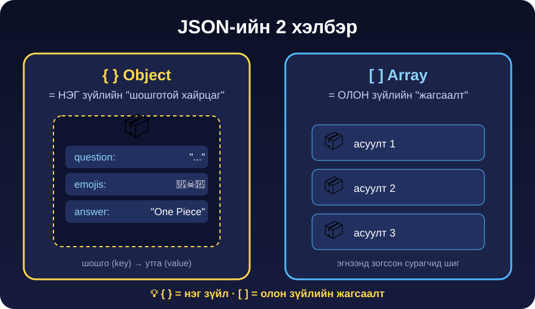
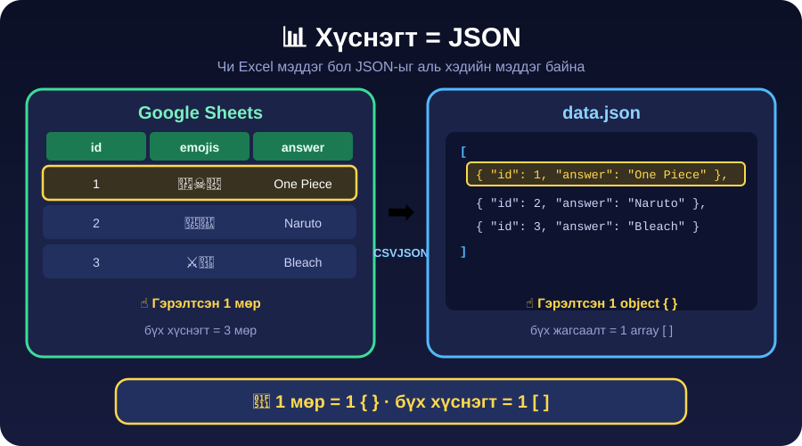
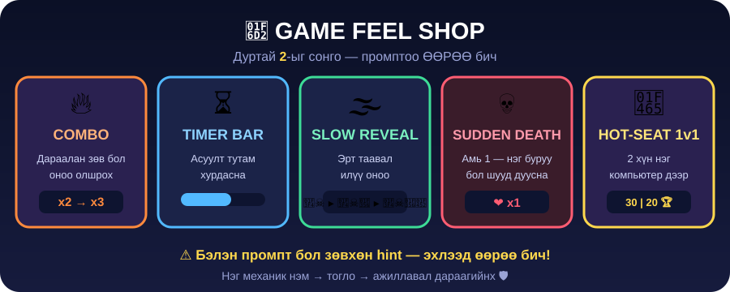

# Anime Guess — JSON дататай таавар тоглоом

> **Агуулга:** JSON (object, array), хүснэгтээс дата бэлдэх, AI-аар датагаа баяжуулах, тоглоом үүсгэх, шинэ горим + game feel нэмж сайтдаа байршуулах.

[Жишээ тоглоом](https://ai.studio/apps/c075aff4-289c-45c8-a050-9207f9afe5ac) · Хэрэгсэл: Google Sheets · [CSVJSON](https://csvjson.com/csv2json) · [JSONLint](https://jsonlint.com) · AI Studio

| #   | Алхам                 | Хугацаа |
| --- | --------------------- | ------- |
| 1   | JSON, object          | 20 мин  |
| 2   | Дата бэлдэх           | 15 мин  |
| 3   | AI-аар баяжуулах      | 10 мин  |
| 4   | Тоглоом үүсгэх        | 15 мин  |
| 5   | Шинэ горим нэмэх      | 20 мин  |
| 6   | Game Feel Shop        | 15 мин  |
| 7   | Сайтаа шинэчлэх       | 10 мин  |

---

<details>
<summary><b>1. JSON, object</b></summary>



| Хэлбэр       | Гэдэг нь      | Жишээ               |
| ------------ | ------------- | ------------------- |
| `{ }` object | **Нэг** зүйл  | Pokémon карт        |
| `[ ]` array  | **Олон** зүйл | Playlist            |

```json
{
  "emojis": "🏴‍☠️🍖👒",
  "answer": "One Piece",
  "options": ["One Piece", "Naruto", "Bleach", "Dragon Ball"]
}
```

**Дүрэм:** key, текст `" "` дотор · талбар хооронд `,` · сүүлчийнх `,`-гүй · нээсэн хаалтаа хаа.

**Засах тэмцээн** — [JSONLint](https://jsonlint.com)-д буулгаад **Validate** → ногоон болтол зас.

```text
{ "id": 1 "answer": "One Piece" }
```

```text
{ id: 2, 'answer': 'Naruto' }
```

```text
{ "id": 3, "options": ["Bleach", "Naruto", }
```

<details>
<summary>Хариу</summary>

1. `1`-ийн дараа `,` алга.
2. `id` хашилтгүй, `' '` биш `" "`.
3. Сүүлийн `,` илүү, `]` хаагаагүй.

</details>

</details>

<details>
<summary><b>2. Дата бэлдэх (хүснэгт → JSON)</b></summary>



**1 мөр = 1 `{ }`** · **бүх хүснэгт = 1 `[ ]`**

1. Google Sheets-д 4 багана:

| id  | emojis | answer    | options                                |
| --- | ------ | --------- | -------------------------------------- |
| 1   | 🏴‍☠️🍖👒 | One Piece | One Piece\|Naruto\|Bleach\|Dragon Ball |

2. 10 аниме асуулт + **3 локал** асуулт (зөвхөн ангийнхан мэдэх хоол, meme, газар). Хүний нэр, шоолол — болохгүй.
3. Бүгдийг сонгоод copy → [CSVJSON](https://csvjson.com/csv2json) → **Convert**.
4. [JSONLint](https://jsonlint.com) → ногоон **Valid** → хадгал.

</details>

<details>
<summary><b>3. AI-аар датагаа баяжуулах</b></summary>

AI Studio-д JSON-оо хавсаргаад:

```text
Доорх JSON-ын асуулт бүрт эдгээр талбарыг нэм:
- "options": "|"-ээр салгасан текстийг 4 элементтэй array болго
- "answers": өөрөөр бичиж болох зөв хариултууд (жижиг үсэг, монголоор)
- "hintSteps": emoji-г 1, 2, 3 ширхэгээр аажмаар нэмсэн array дотор array
- "difficulty": "easy", "medium" эсвэл "hard"
- "fact": 1 өгүүлбэр сонирхолтой баримт
Зөвхөн valid JSON буцаа.

[JSON-ОО ЭНД БУУЛГА]
```

**Шалга:** JSONLint ногоон уу? AI эндүүрээгүй юу?

**Зураг нэмэх** — зураг дээр баруун товч → **Copy image address** → `"image"` талбарт тавь.

| Эх сурвалж                                           | Юунд                       |
| ---------------------------------------------------- | -------------------------- |
| [Wikipedia](https://www.wikipedia.org)               | Аниме, хүн, газар, кино    |
| [Fandom](https://www.fandom.com) (тухайн анимийн wiki) | Баатрын зураг              |
| [MyAnimeList](https://myanimelist.net)               | Анимийн poster             |
| [Unsplash](https://unsplash.com)                     | Амьтан, хоол, байгаль      |

**Шалга:** хаягийг шинэ tab-д нээхэд **зөвхөн зураг** гарах ёстой. Google Images-ийн хаяг ихэвчлэн ажилладаггүй. Ажиллахгүй бол зургаа AI Studio төсөлдөө upload хий.

</details>

<details>
<summary><b>4. Тоглоом үүсгэх</b></summary>

Дүрмээ шийд: хугацаа `__` сек · амь `__` · оноо `+__`

Portfolio-гоо AI Studio-д нээгээд:

```text
Сайтдаа "Миний тоглоомууд" цэс нэм. Дотор нь "Anime Guess" тоглоом.

ЯВЦ:
- Emoji харуулж, 4 сонголтоос анимийг таалгана.
- Асуулт бүрт [__] секунд. Цаг дуусвал буруу.
- [__] амьтай. Амь дуусвал оноог харуулж "Дахин тоглох" товч гарга.
- Зөв бол +[__] оноо. Оноо, амь, цагийг байнга харуул.

ДАТА:
- Асуултуудыг "data.json" файлаас унш. Агуулга нь доорх JSON.
- "image" байвал зөв хариулсны дараа харуул. Ачаалагдахгүй бол нуу.
- Доод талд "Зургийн эх сурвалж: [ЭХ СУРВАЛЖУУД]" гэж бич.

[БАЯЖУУЛСАН JSON-ОО ЭНД БУУЛГА]
```

**Шалга:** асуулт гарна · оноо нэмэгдэнэ · амь хасагдана · тоглоом дуусна. Бүгд ажиллатал цааш бүү яв.

<details>
<summary>Ажиллахгүй бол</summary>

```text
Тоглоом [юу болохгүй байгаа] байна. Шалгаад засаач.
```

Console-д улаан алдаа байвал хуулж AI-д өг.

</details>

</details>

<details>
<summary><b>5. Шинэ горим нэмэх</b></summary>

Сэдэв сонго: хөлбөмбөг · кино · K-pop · Монголын түүх · тоглоом.

1. Алхам 2–3-ыг шинэ сэдвээр давт (8–10 асуулт).
2. Data бүтэц — **object дотор array-ууд**:

```json
{
  "anime": [{ "emojis": "🍥🍜🦊", "answer": "Naruto" }],
  "football": [{ "emojis": "🇦🇷🐐🏆", "answer": "Messi" }]
}
```

3. AI Studio-д:

```text
Тоглоомдоо "[СЭДЭВ]" гэсэн 2 дахь горим нэм.
- data.json-ыг object болго: одоогийн асуултууд "anime" array-д,
  доорх шинэ асуултууд "[СЭДЭВ]" array-д.
- Эхлэхэд "Ямар горимоор тоглох вэ?" гэж асууж товч гарга.
- Тоглоом дуусахад горим сонгох руу буцах товч байг.
- Хугацаа, амь, оноо, зураг хоёр горимд адил ажиллана.

[ШИНЭ JSON]
```

> **Код = дүрэм · Дата = агуулга.** Шинэ горим = шинэ дата, код дахин бичихгүй.

</details>

<details>
<summary><b>6. Game Feel Shop</b></summary>



**2 механик сонго. Промптоо өөрөө бич** — hint-ийг гацвал л нээ.

| Механик      | Зорилго                                                   |
| ------------ | --------------------------------------------------------- |
| COMBO        | Дараалан зөв → x2, x3. Буруу бол 0                        |
| TIMER BAR    | Цагийн зурвас багасна, 3 сек үлдэхэд улаан                |
| SLOW REVEAL  | Emoji аажмаар гарна (`hintSteps`), эрт таавал их оноо     |
| SUDDEN DEATH | 1 амь, хамгийн сайн үзүүлэлтээ хадгална                   |
| 1v1          | 2 тоглогч ээлжилнэ, төгсгөлд ялагч                        |

<details>
<summary>Hint — COMBO</summary>

```text
Combo нэм: 2 дараалан зөв бол x2, 3+ бол x3. Дээр нь "COMBO x3!"
том, өнгөтэй харуул. Буруу бол combo 0.
```

</details>

<details>
<summary>Hint — TIMER BAR</summary>

```text
Асуулт бүрийн дээр цагийн зурвас нэм. Эхэндээ 15 сек, асуулт тутам
1 сек хасагдана (доод тал 6). 3 сек үлдэхэд улаан болж анивчина.
```

</details>

<details>
<summary>Hint — SLOW REVEAL</summary>

```text
"hintSteps"-ийг ашиглаж emoji-г 3 сек тутам нэг нэгээр гаргаач.
1-р шатанд таавал +30, 2-р шатанд +20, 3-р шатанд +10.
```

</details>

<details>
<summary>Hint — SUDDEN DEATH</summary>

```text
"Sudden Death" горим нэм: 1 амь, нэг буруу бол дуусна. Даасан
асуултын тоог харуулж, хамгийн сайн үзүүлэлтийг браузерт хадгал.
```

</details>

<details>
<summary>Hint — 1v1</summary>

```text
"1v1" горим нэм: 2 тоглогчийн нэр асуугаад ээлжлэн асуулт өг.
Хоёулангийн оноог дээр харуул, төгсгөлд ялагчийг том харуул.
```

</details>

**Нэмэлт:** зөв бол ногоон + "ding", буруу бол улаан + сэгсрэх, сайн дуусвал confetti.

</details>

<details>
<summary><b>7. Сайтаа шинэчлэх</b></summary>

1. AI Studio → GitHub руу sync.
2. Vercel автоматаар шинэчилнэ.
3. Утаснаасаа нээж шалга → линкээ Discord-д тавь.
4. Найзынхаа 3 тоглоомыг тогло. Шагнал: **хамгийн хатуу асуулт · хамгийн гоё мэдрэмж · хамгийн инээдтэй**.

> Тоглоом интернэтэд ил. Локал асуулт хэн нэгнийг гомдоохгүй эсэхийг дахин шалга.

</details>

---

<details>
<summary><b>Гэрийн даалгавар</b></summary>

1. "Баатар таах" горим нэм — баатрын зургийг харуулж, нэрийг 4 сонголтоос таалгана.
2. [W3Schools JSON дасгал](https://www.w3schools.com/js/exercise.asp?filename=exercise_js_json1) хий.

</details>
