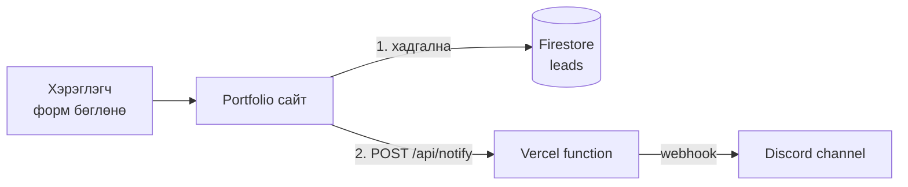

# Service захиалга — Firestore + Discord

### Portfolio-доо **үйлчилгээ** нэмж, "Захиалах" дарахад мэдээлэл **бааз**-д хадгалагдаж, **Discord**-д мэдэгдэл ирнэ.

> **Агуулга:** _(төлөвлөсөн, Adult 16+ · for давталтын дараа)_ Discord webhook-ийг F12-оос туршина → AI Studio-д Services + форм шууд Discord руу → URL ил байгааг харж Vercel `/api` + env-ээр нууцална → Firebase Firestore (Rules)-д хадгална.



| #   | Алхам                                   | Хугацаа |
| --- | --------------------------------------- | ------- |
| 0   | Бэлтгэл                                 | 5 мин   |
| 1   | Discord webhook + F12 тест              | 10 мин  |
| 2   | Үйлчилгээгээ төлөвлө                    | 5 мин   |
| 3   | Services + форм → шууд Discord          | 20 мин  |
| 4   | URL ил байна: найзынхаа channel-д бич   | 5 мин   |
| 5   | Нууцлах: Vercel `/api` + env            | 25 мин  |
| 6   | Firestore-д хадгалах                    | 40 мин  |
| 7   | Шалгах                                  | 10 мин  |

> Алхам бүр дээр **дарж нээнэ**.

---

<details>
<summary><b>0. Бэлтгэл</b></summary>

<br>

| Хэрэгтэй                        | Шалга                                  |
| ------------------------------- | -------------------------------------- |
| AI Studio Build portfolio       | Хичээл 7-д хийсэн апп нээгдэж байна уу |
| GitHub sync + Vercel            | Vercel линк ажиллаж байна уу           |
| Google account                  | Firebase-д нэвтрэнэ                    |
| Discord account + өөрийн server | Байхгүй бол: **+** → **Create My Own** |

</details>

---

<details>
<summary><b>1. Discord webhook + F12 тест</b></summary>

<br>

1. Discord server → шинэ text channel `#zahialga`.
2. Channel-ийн **⚙ Edit Channel** → **Integrations** → **Webhooks** → **New Webhook** → **Copy Webhook URL**.
3. Браузерт дурын хуудас → **F12** → **Console** → URL-ээ тавиад Enter:

```js
fetch("ЭНД_WEBHOOK_URL", {
  method: "POST",
  headers: { "Content-Type": "application/json" },
  body: JSON.stringify({ content: "Сайн уу! Миний анхны bot" })
})
```

**Шалга:** `#zahialga`-д мессеж ирсэн үү? `content`-ийг өөрчлөөд дахин илгээ.

<details>
<summary>Webhook гэж юу вэ?</summary>

<br>

Discord-оос өгсөн **тусгай хаяг**. Тэр хаяг руу мэдээлэл (POST) илгээвэл channel-д мессеж болж гарна. Нууц үг шаардахгүй — тиймээс **URL өөрөө нууц үг** юм.

</details>

</details>

---

<details>
<summary><b>2. Үйлчилгээгээ төлөвлө</b></summary>

<br>

Чи юу хийж чадах вэ? **3 үйлчилгээ** бич (жинхэнэ эсвэл ирээдүйд хийх).

| Нэр            | Товч тайлбар                | Үнэ        |
| -------------- | --------------------------- | ---------- |
| Landing page   | 1 хуудас вэб, 3 хоногт      | 150,000₮-с |
| Logo дизайн    | AI + гар засвар, 3 хувилбар | 50,000₮-с  |
| Instagram пост | 10 пост, Canva загвартай    | 80,000₮-с  |

<details>
<summary>for давталттай холбоо</summary>

<br>

AI үйлчилгээнүүдийг **жагсаалт** (массив) болгож хадгална, тэгээд давталтаар карт бүрийг зурна. 3 биш 30 үйлчилгээтэй байсан ч код нь өөрчлөгдөхгүй — энэ бол `for`-ийн хүч. 3-р алхмын дараа кодоос нь хайж олоорой.

</details>

</details>

---

<details>
<summary><b>3. Services + форм → шууд Discord</b></summary>

<br>

AI Studio → **Build** → portfolio аппаа нээ → чатад:

```text
Portfolio-д "Services" хэсэг нэм:
- Үйлчилгээ бүр карт: нэр, тайлбар, үнэ, "Захиалах" товч.
- Үйлчилгээнүүд: [2-р алхмын хүснэгтээ энд хуул]
- Үйлчилгээнүүдийг кодонд нэг массивт хадгалж, давталтаар (map) карт болгон харуул.
- "Захиалах" дарахад modal форм нээгдэнэ. Талбарууд:
  name (нэр, заавал), contact (утас эсвэл email, заавал),
  service (сонгосон үйлчилгээ, автоматаар бөглөгдөнө), message (нэмэлт мэдээлэл).
- Навигацид "Services", "Contact" линк нэм. Contact товч мөн ижил формыг (service хоосон) нээнэ.
- Илгээхэд fetch-ээр энэ Discord webhook руу POST хий (JSON):
  [webhook URL]
  content: "Шинэ захиалга" + нэр, холбоо барих, үйлчилгээ, мессеж — мөр мөрөөр.
  allowed_mentions: { parse: [] } нэм.
- Илгээж байхад товч "Илгээж байна..." болж идэвхгүй болно.
- Амжилттай: "Баярлалаа! Удахгүй холбогдоно." Алдаа: "Алдаа гарлаа, дахин оролдоно уу."
```

**Шалга:** Preview-д карт дарж форм илгээ → Discord-д захиалга ирсэн үү?

<details>
<summary>Массиваа ол</summary>

<br>

**Code** таб → `services` гэж хайгаад (Ctrl+F) массивыг ол. Шинэ үйлчилгээ **гараараа** нэмээд preview-д 4 дэх карт гарч ирэхийг хар.

</details>

</details>

---

<details>
<summary><b>4. URL ил байна: найзынхаа channel-д бич</b></summary>

<br>

1. Хажуу найзынхаа сайтыг нээ → **F12** → **Sources** (эсвэл **Network** → форм илгээ) → `discord.com/api/webhooks` гэж хай.
2. Олдсон URL-ээр 1-р алхмын `fetch`-ийг ажиллуулж найзынхаа channel-д мессеж бич.

**Дүгнэлт:** Браузерийн код = хэн ч харж болно. URL ил байвал хэн ч spam илгээнэ. Тиймээс URL-ийг **сервер** (Vercel) дээр нууцална.

</details>

---

<details>
<summary><b>5. Нууцлах: Vercel <code>/api</code> + env</b></summary>

<br>

1. Discord → **Webhooks** → хуучин webhook-оо **Delete** → **New Webhook** → шинэ URL хуул. (Хуучин ил гарсан URL ажиллахаа болино.)
2. AI Studio чатад:

   ```text
   Форм Discord руу шууд илгээхээ боль, webhook URL-ийг кодоос бүр мөсөн устга.
   Оронд нь fetch("/api/notify", POST, JSON {name, contact, service, message}) дууд.
   ```

3. AI Studio → **GitHub** товч → **push**. VSCode → `my-portfolio` → `git pull`.
4. Root-д `api` хавтас үүсгэж [api/notify.js](api/notify.js)-ийг хуул.
5. Vercel → project → **Settings → Environment Variables**:

   | Key                   | Value             |
   | --------------------- | ----------------- |
   | `DISCORD_WEBHOOK_URL` | **шинэ** URL      |

6. VSCode-оос push:

   ```bash
   git add .
   git commit -m "Discord notify API"
   git push
   ```

7. Vercel автоматаар deploy хийнэ (env шинээр нэмсэн бол **Deployments → Redeploy**).

**Шалга:** Vercel линкээс захиалга илгээ → Discord-д карт ирсэн үү? F12-оор хайхад webhook URL олдохгүй байна уу?

| Алдаа             | Шалтгаан                                                   |
| ----------------- | ---------------------------------------------------------- |
| `/api/notify` 404 | AI Studio preview-д хэвийн — `/api` зөвхөн Vercel дээр ажиллана |
| 502               | Vercel env-д URL буруу эсвэл Redeploy хийгээгүй            |

<details>
<summary><code>api/notify.js</code> юу хийдэг вэ</summary>

<br>

| Мөр                               | Утга                                             |
| --------------------------------- | ------------------------------------------------ |
| `req.method !== "POST"`           | Зөвхөн форм илгээхэд ажиллана                    |
| `req.body`                        | Формын мэдээлэл                                  |
| `process.env.DISCORD_WEBHOOK_URL` | Нууц URL — кодонд биш, Vercel-д                  |
| `allowed_mentions: { parse: [] }` | Хэн нэг `@everyone` бичвэл хүн бүрт ping очихгүй |
| `embeds`                          | Discord-д гоё карт болж харагдана                |

</details>

<details>
<summary>Local-д турших (заавал биш)</summary>

<br>

`npm run dev` нь `/api`-г ажиллуулахгүй. Турших бол `npx vercel dev` (Vercel-д нэвтэрсэн байх).

</details>

</details>

---

<details>
<summary><b>6. Firestore-д хадгалах</b></summary>

<br>

Discord мессеж алга болж болно — захиалгыг **бааз**-д ч хадгална.

1. [console.firebase.google.com](https://console.firebase.google.com) → **Create a project** → нэр: `my-portfolio` → Analytics **off**.
2. Зүүн цэс **Build → Firestore Database** → **Create database** → байршил `asia-east1` → **Start in production mode**.
3. **Rules** таб → бүгдийг устгаад [firestore.rules](firestore.rules)-ийг хуул → **Publish**.
4. Project Overview → **`</>`** (Web app) → нэр өг → **Register** → `firebaseConfig { ... }` блокыг хуулж ав.
5. AI Studio чатад (config-оо хуулж тавь):

   ```text
   Захиалгын формыг Firebase Firestore-д холбо.
   - firebase npm package ашигла, тусдаа firebase.ts файл үүсгэ.
   - firebaseConfig:
     [энд config-оо тавь]
   - Илгээхэд эхлээд "leads" collection-д addDoc хий. Яг эдгээр талбар:
     name, contact, service, message (string), createdAt: serverTimestamp().
     Өөр талбар бүү нэм (Firestore Rules зөвхөн эдгээрийг зөвшөөрнө).
   - Дараа нь /api/notify-г өмнөх шигээ дууд. Энэ алдаа гарвал хэрэглэгчид бүү харуул, зөвхөн console.warn.
   ```

6. GitHub push → VSCode `git pull` (`api/` хавтас үлдсэн эсэхийг шалга) → Vercel deploy.

**Турш:** Preview-д форм илгээ → Firebase → Firestore → **Data** → `leads` дотор мөр нэмэгдсэн үү?

| Rules юу хийдэг вэ                 | Яагаад                                    |
| ---------------------------------- | ----------------------------------------- |
| `create` — зөвхөн 5 талбар, богино | Хэн ч захиалга үлдээж чадна, spam багасна |
| `read, update, delete: false`      | Бусдын утас, email-ийг хэн ч харахгүй     |

| Алдаа                                 | Шалтгаан                                                   |
| ------------------------------------- | ---------------------------------------------------------- |
| `Missing or insufficient permissions` | Талбарын нэр/тоо Rules-тэй таарахгүй — AI-д алдааг хуулж өг |

<details>
<summary>firebaseConfig нууц биш үү?</summary>

<br>

Үгүй — `apiKey` нь браузерт ил харагддаг, зөвхөн "аль project" гэдгийг заана. Баазыг **Rules** хамгаална. Харин Discord webhook URL бол жинхэнэ нууц (4-р алхам).

</details>

</details>

---

<details>
<summary><b>7. Шалгах</b></summary>

<br>

Vercel линкээ **утсаараа** нээгээд захиалга өг.

| Шалгах                                 | ✔ |
| -------------------------------------- | - |
| Firestore `leads`-д шинэ мөр           |   |
| Discord `#zahialga`-д карт ирсэн       |   |
| Хоосон нэртэй илгээхэд зөвшөөрөхгүй    |   |
| GitHub, F12-д webhook URL **байхгүй**  |   |
| F12 → Console-д улаан алдаа байхгүй    |   |

</details>

---

<details>
<summary><b>Бонус</b></summary>

<br>

- Firestore-д `status: "new"` нэмж, Rules-ээ шинэчил (`hasOnly`-д нэм).
- Discord embed-д үйлчилгээ бүрт өөр `color` өг.
- Хуурамч bot-оос хамгаалах: формд нуугдмал `website` талбар — бөглөгдсөн бол илгээхгүй (honeypot).

</details>

---

## Гэрийн даалгавар

1. Найз 2-оороо сайт дээрээ жинхэнэ захиалга өгүүлж, Discord-д ирснийг screenshot хий.
2. 1 шинэ үйлчилгээг кодонд **гараараа** нэмээд push хий.
