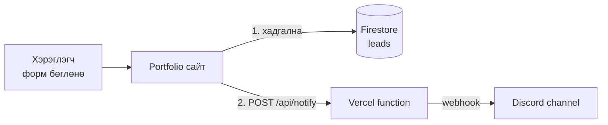

# Service захиалга — Firestore + Discord

### Portfolio-доо **үйлчилгээ** нэмж, "Захиалах" дарахад мэдээлэл **бааз**-д хадгалагдаж, **Discord**-д мэдэгдэл ирнэ.

> **Агуулга:** _(төлөвлөсөн, Adult 16+ · for давталтын дараа)_ AI Studio-д Services хэсэг + захиалгын форм, Firebase Firestore (Rules), Discord webhook, Vercel `/api` function + env хувьсагч.



| #   | Алхам                        | Хугацаа |
| --- | ---------------------------- | ------- |
| 0   | Бэлтгэл                      | 5 мин   |
| 1   | Үйлчилгээгээ төлөвлө         | 10 мин  |
| 2   | Services + форм (AI Studio)  | 20 мин  |
| 3   | Firebase Firestore           | 25 мин  |
| 4   | Формыг Firestore-д холбох    | 15 мин  |
| 5   | Discord webhook              | 10 мин  |
| 6   | Vercel `/api` + env          | 25 мин  |
| 7   | Шалгах                       | 10 мин  |

> Алхам бүр дээр **дарж нээнэ**.

---

<details>
<summary><b>0. Бэлтгэл</b></summary>

<br>

| Хэрэгтэй                       | Шалга                                     |
| ------------------------------ | ----------------------------------------- |
| AI Studio Build portfolio      | Хичээл 7-д хийсэн апп нээгдэж байна уу    |
| GitHub sync + Vercel           | Vercel линк ажиллаж байна уу              |
| Google account                 | Firebase-д нэвтрэнэ                       |
| Discord account + өөрийн server | Байхгүй бол: **+** → **Create My Own**   |

</details>

---

<details>
<summary><b>1. Үйлчилгээгээ төлөвлө</b></summary>

<br>

Чи юу хийж чадах вэ? **3 үйлчилгээ** бич (жинхэнэ эсвэл ирээдүйд хийх).

| Нэр             | Товч тайлбар                 | Үнэ        |
| --------------- | ---------------------------- | ---------- |
| Landing page    | 1 хуудас вэб, 3 хоногт       | 150,000₮-с |
| Logo дизайн     | AI + гар засвар, 3 хувилбар  | 50,000₮-с  |
| Instagram пост  | 10 пост, Canva загвартай     | 80,000₮-с  |

<details>
<summary>for давталттай холбоо</summary>

<br>

AI үйлчилгээнүүдийг **жагсаалт** (массив) болгож хадгална, тэгээд давталтаар карт бүрийг зурна. 3 биш 30 үйлчилгээтэй байсан ч код нь өөрчлөгдөхгүй — энэ бол `for`-ийн хүч. 2-р алхмын дараа кодоос нь хайж олоорой.

</details>

</details>

---

<details>
<summary><b>2. Services + форм (AI Studio)</b></summary>

<br>

AI Studio → **Build** → portfolio аппаа нээ → чатад:

```text
Portfolio-д "Services" хэсэг нэм:
- Үйлчилгээ бүр карт: нэр, тайлбар, үнэ, "Захиалах" товч.
- Үйлчилгээнүүд: [1-р алхмын хүснэгтээ энд хуул]
- Үйлчилгээнүүдийг кодонд нэг массивт хадгалж, давталтаар (map) карт болгон харуул.
- "Захиалах" дарахад modal форм нээгдэнэ. Талбарууд:
  name (нэр, заавал), contact (утас эсвэл email, заавал),
  service (сонгосон үйлчилгээ, автоматаар бөглөгдөнө), message (нэмэлт мэдээлэл).
- Илгээх товч. Одоохондоо илгээхэд зөвхөн console.log хий.
- Навигацид "Services", "Contact" линк нэм. Contact товч мөн ижил формыг (service хоосон) нээнэ.
```

**Шалга:** Карт дээр дарахад форм нээгдэж, үйлчилгээний нэр бөглөгдсөн үү?

<details>
<summary>Массиваа ол</summary>

<br>

**Code** таб → `services` гэж хайгаад (Ctrl+F) массивыг ол. Шинэ үйлчилгээ **гараараа** нэмээд preview-д 4 дэх карт гарч ирэхийг хар.

</details>

</details>

---

<details>
<summary><b>3. Firebase Firestore</b></summary>

<br>

1. [console.firebase.google.com](https://console.firebase.google.com) → **Create a project** → нэр: `my-portfolio` → Analytics **off**.
2. Зүүн цэс **Build → Firestore Database** → **Create database** → байршил `asia-east1` → **Start in production mode**.
3. **Rules** таб → бүгдийг устгаад [firestore.rules](firestore.rules)-ийг хуул → **Publish**.
4. Project Overview → **`</>`** (Web app) → нэр өг → **Register** → `firebaseConfig { ... }` блокыг хуулж ав.

| Rules юу хийдэг вэ                 | Яагаад                                  |
| ---------------------------------- | --------------------------------------- |
| `create` — зөвхөн 5 талбар, богино | Хэн ч захиалга үлдээж чадна, spam багасна |
| `read, update, delete: false`      | Бусдын утас, email-ийг хэн ч харахгүй    |

<details>
<summary>firebaseConfig нууц биш үү?</summary>

<br>

Үгүй — `apiKey` нь браузерт ил харагддаг, зөвхөн "аль project" гэдгийг заана. Баазыг **Rules** хамгаална. Харин **Discord webhook URL** бол жинхэнэ нууц (5-р алхам).

</details>

</details>

---

<details>
<summary><b>4. Формыг Firestore-д холбох</b></summary>

<br>

AI Studio чатад (config-оо хуулж тавь):

```text
Захиалгын формыг Firebase Firestore-д холбо.
- firebase npm package ашигла, тусдаа firebase.ts файл үүсгэ.
- firebaseConfig:
  [энд config-оо тавь]
- Илгээхэд "leads" collection-д addDoc хий. Яг эдгээр талбар:
  name, contact, service, message (string), createdAt: serverTimestamp().
  Өөр талбар бүү нэм (Firestore Rules зөвхөн эдгээрийг зөвшөөрнө).
- Хадгалсны дараа fetch("/api/notify", POST, JSON {name, contact, service, message}) дуудна.
  Энэ алдаа гарвал хэрэглэгчид бүү харуул, зөвхөн console.warn.
- Илгээж байхад товч "Илгээж байна..." болж идэвхгүй болно.
- Амжилттай: "Баярлалаа! Удахгүй холбогдоно." Алдаа: "Алдаа гарлаа, дахин оролдоно уу."
```

**Турш:** Preview-д форм илгээ → Firebase → Firestore → **Data** → `leads` дотор мөр нэмэгдсэн үү?

| Алдаа                        | Шалтгаан                                      |
| ---------------------------- | --------------------------------------------- |
| `Missing or insufficient permissions` | Талбарын нэр/тоо Rules-тэй таарахгүй — AI-д алдааг хуулж өг |
| `/api/notify` 404            | Хэвийн — AI Studio-д `/api` байхгүй, 6-р алхамд Vercel дээр ажиллана |

</details>

---

<details>
<summary><b>5. Discord webhook</b></summary>

<br>

1. Discord server → шинэ text channel `#zahialga`.
2. Channel-ийн **⚙ Edit Channel** → **Integrations** → **Webhooks** → **New Webhook** → **Copy Webhook URL**.
3. URL-ээ **хаана ч бүү нийтэл** (GitHub, код, чат). Энэ URL-тэй хүн бүр channel-д чинь мессеж бичиж чадна.

<details>
<summary>Яагаад шууд браузераас Discord руу илгээж болохгүй вэ?</summary>

<br>

Браузерийн код = хэн ч F12-оор харж болно. URL ил гарвал spam ирнэ. Тиймээс **сервер** (Vercel function) дунд нь орж, URL-ийг нууц env-д хадгална.

</details>

</details>

---

<details>
<summary><b>6. Vercel <code>/api</code> + env</b></summary>

<br>

1. AI Studio → **GitHub** товч → өөрчлөлтөө **push**.
2. VSCode → `my-portfolio` → `git pull`.
3. Root-д `api` хавтас үүсгэж [api/notify.js](api/notify.js)-ийг хуул.
4. Vercel → project → **Settings → Environment Variables**:

   | Key                   | Value                    |
   | --------------------- | ------------------------ |
   | `DISCORD_WEBHOOK_URL` | 5-р алхмын URL           |

5. VSCode-оос push:

   ```bash
   git add .
   git commit -m "Discord notify API"
   git push
   ```

6. Vercel автоматаар deploy хийнэ (env шинээр нэмсэн бол **Deployments → Redeploy**).

<details>
<summary><code>api/notify.js</code> юу хийдэг вэ</summary>

<br>

| Мөр                               | Утга                                        |
| --------------------------------- | ------------------------------------------- |
| `req.method !== "POST"`           | Зөвхөн форм илгээхэд ажиллана               |
| `req.body`                        | Формын мэдээлэл                             |
| `process.env.DISCORD_WEBHOOK_URL` | Нууц URL — кодонд биш, Vercel-д             |
| `allowed_mentions: { parse: [] }` | Хэн нэг `@everyone` бичвэл хүн бүрт ping очихгүй |
| `embeds`                          | Discord-д гоё карт болж харагдана           |

</details>

<details>
<summary>Local-д турших (заавал биш)</summary>

<br>

`npm run dev` нь `/api`-г ажиллуулахгүй. Турших бол `npx vercel dev` (Vercel-д нэвтэрсэн байх).

</details>

</details>

---

<details>
<summary><b>7. Шалгах</b></summary>

<br>

Vercel линкээ **утсаараа** нээгээд захиалга өг.

| Шалгах                                  | ✔ |
| --------------------------------------- | - |
| Firestore `leads`-д шинэ мөр            |   |
| Discord `#zahialga`-д карт ирсэн        |   |
| Хоосон нэртэй илгээхэд зөвшөөрөхгүй     |   |
| GitHub-д webhook URL **байхгүй** (хай)  |   |
| F12 → Console-д улаан алдаа байхгүй     |   |

</details>

---

<details>
<summary><b>Бонус</b></summary>

<br>

- Firestore-д `status: "new"` нэмж, Rules-ээ шинэчил (`hasOnly`-д нэм).
- Discord embed-д үйлчилгээ бүрт өөр `color` өг.
- Хуурамч bot-оос хамгаалах: формд нуугдмал `website` талбар — бөглөгдсөн бол илгээхгүй (honeypot).

</details>

---

## Гэрийн даалгавар

1. Найз 2-оороо сайт дээрээ жинхэнэ захиалга өгүүлж, Discord-д ирснийг screenshot хий.
2. 1 шинэ үйлчилгээг кодонд **гараараа** нэмээд push хий.
