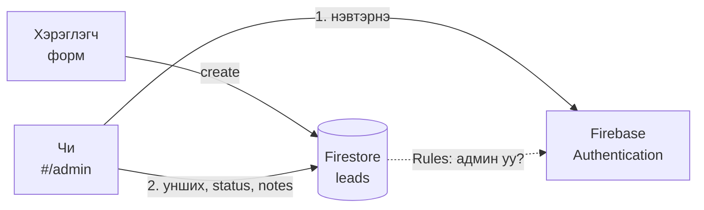
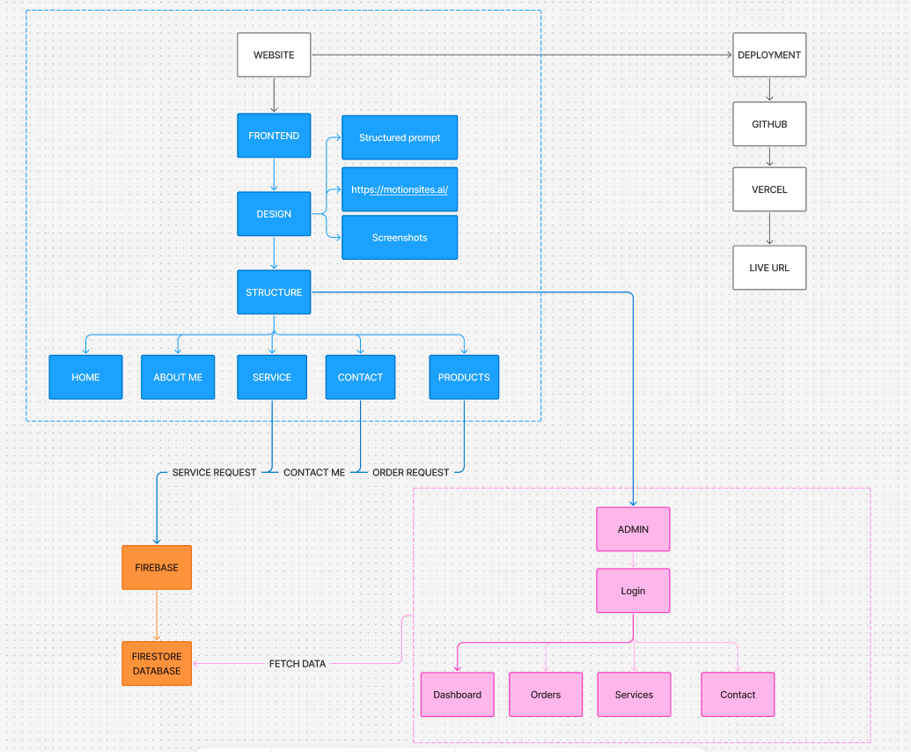
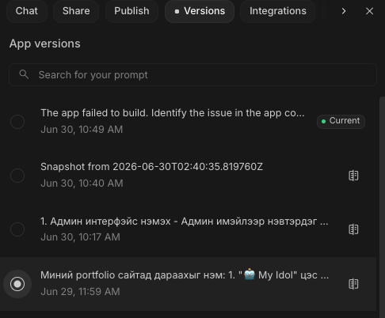
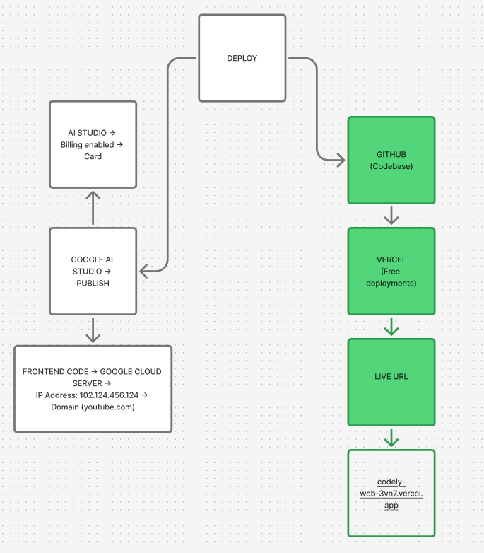

# Админ хэсэг — нэвтрэлт + захиалга удирдах

### Ирсэн захиалгуудаа **өөрийн сайт дээрээ** харж, статус өөрчилж, тэмдэглэл үлдээнэ. Зөвхөн чи нэвтэрнэ.

> **Агуулга:** _(төлөвлөсөн, Adult 16+ · [Service захиалга](../Service%20захиалга/readme.md)-ийн дараа)_ Сайтаа эцэслэх checklist → веб апп том зургаар (frontend / database / admin) → AI Studio Versions-оор буцах → Firebase Authentication-д админ хэрэглэгч → Rules-ээр зөвхөн админд унших эрх → AI Studio-д Админ хэсэг (dashboard, хүснэгт, статус, тэмдэглэл) → Vercel + QR.



| #   | Алхам                                  | Хугацаа |
| --- | -------------------------------------- | ------- |
| 0   | Бэлтгэл                                | 5 мин   |
| 1   | Сайтаа эцэслэх                         | 15 мин  |
| 2   | Веб апп том зургаар                    | 10 мин  |
| 3   | Алдаа гарвал буцах: Versions           | 5 мин   |
| 4   | Админ хэрэглэгч үүсгэх                 | 15 мин  |
| 5   | Rules: зөвхөн админ уншина             | 10 мин  |
| 6   | Админ хэсэг — AI Studio prompt         | 30 мин  |
| 7   | Vercel + хамгаалалт шалгах             | 15 мин  |
| 8   | QR + Share                             | 10 мин  |

> Алхам бүр дээр **дарж нээнэ**.

---

<details>
<summary><b>0. Бэлтгэл</b></summary>

<br>

| Хэрэгтэй                           | Шалга                                         |
| ---------------------------------- | --------------------------------------------- |
| Service захиалга хичээл дууссан    | Vercel линкээс форм илгээхэд Discord-д ирж байна |
| Firestore `leads`                  | Дотор нь **3+ захиалга** байна (байхгүй бол найзаар өгүүл) |
| `firebase.ts`                      | AI Studio → Code-д байна                       |

</details>

---

<details>
<summary><b>1. Сайтаа эцэслэх</b></summary>

<br>

Админ хийхээс өмнө нүүр хуудсаа **дуусга**. Дутуу зүйлийг AI Studio чатад нэг нэгээр нь засуул.

| ✔ | Хэсэг                                                          |
| - | -------------------------------------------------------------- |
|   | **Контент бодит** — жинхэнэ нэр, үйлчилгээ, үнэ, холбоо барих  |
|   | **Hero** — 1 хүчтэй өгүүлбэр + тодорхой "Захиалах" товч         |
|   | **Утсан дээр** — F12 → утасны дүрс (Ctrl+Shift+M) → эвдрэлгүй   |
|   | **Өнгө / фонт** — 2–3 өнгө, уншигдахуйц                         |
|   | **Форм** — Services болон Contact-оос нээгддэг                  |

<details>
<summary>Prompt жишээ</summary>

<br>

```text
Утсан дээр (375px) Services картууд нэг баганаар, товч томоор харагддаг болго.
Өөр юу ч бүү өөрчил.
```

"Өөр юу ч бүү өөрчил" — AI ажилласан хэсгийг эвдэхээс хамгаална.

</details>

</details>

---

<details>
<summary><b>2. Веб апп том зургаар</b></summary>

<br>



| Хэсэг        | Юу хийдэг                          | Чиний сайтад            |
| ------------ | ---------------------------------- | ----------------------- |
| **Frontend** | Хэрэглэгчид харагдана              | Home, Services, Contact |
| **Database** | Датаг байнга хадгална              | Firestore `leads`       |
| **Admin**    | Зөвхөн эзэн нь датаг харж, удирдана | `#/admin` — өнөөдөр     |
| **Deploy**   | Интернэтэд гаргана                 | GitHub → Vercel         |

Firestore: **collection → document → (sub)collection**.

```text
leads                         ← collection
 ├─ aB3x…                     ← document (1 захиалга)
 │   { name, contact, service, message, createdAt, status }
 │   └─ notes                 ← subcollection (өнөөдөр)
 │       ├─ { text, author, createdAt }
 │       └─ …
 └─ Kp9q…
```

</details>

---

<details>
<summary><b>3. Алдаа гарвал буцах: Versions</b></summary>

<br>

Өнөөдөр том өөрчлөлт хийнэ. AI эвдвэл **өмнөх хувилбар руу** буцаж болно.

AI Studio → дээд талын **Versions** → ажилладаг байсан хувилбараа сонго → **Restore version**.



<details>
<summary>Хэзээ ашиглах вэ</summary>

<br>

| Байдал                                           | Хий                                  |
| ------------------------------------------------ | ------------------------------------ |
| Алдааг AI-д 2 удаа хуулж өгсөн ч засагдахгүй     | Restore → prompt-оо **жижиглээд** дахин |
| AI хүсээгүй хэсгийг өөрчилсөн                    | Restore → prompt-д "өөр юу ч бүү өөрчил" |

</details>

</details>

---

<details>
<summary><b>4. Админ хэрэглэгч үүсгэх</b></summary>

<br>

1. [console.firebase.google.com](https://console.firebase.google.com) → `my-portfolio` → **Build → Authentication** → **Get started**.
2. **Sign-in method** → **Email/Password** → **Enable** → Save.
3. **Users** → **Add user** → өөрийн email + хүчтэй нууц үг. Энэ бол **админ**.
4. Дахин **Add user** → `test@test.com` + нууц үг. Энэ бол **админ биш** хэрэглэгч (7-р алхамд шалгана).
5. Админ мөрийн **User UID**-г хуулж ав.

<details>
<summary>Яагаад "Бүртгүүлэх" товч хийхгүй вэ?</summary>

<br>

Хэрэглэгчийг зөвхөн Console-оос гараар нэмнэ. Хэн нэг API-аар бүртгүүлсэн ч **Rules** зөвхөн чиний UID-д эрх өгнө (5-р алхам). Бүр хаах бол: Authentication → **Settings → User actions** → **Enable create (sign-up)**-ийг унтраа.

</details>

</details>

---

<details>
<summary><b>5. Rules: зөвхөн админ уншина</b></summary>

<br>

1. Firestore Database → **Rules** → бүгдийг устгаад [firestore.rules](firestore.rules)-ийг хуул.
2. `'ЭНД_UID'`-г өөрийн UID-ээр соль (хашилтыг үлдээ) → **Publish**.

| Үйлдэл                    | Хэн                          |
| ------------------------- | ---------------------------- |
| Захиалга үүсгэх           | Хэн ч (өмнөхтэй ижил)        |
| Захиалга унших            | Зөвхөн админ                 |
| `status` өөрчлөх          | Зөвхөн админ, 5 утгын нэг    |
| Тэмдэглэл нэмэх / унших   | Зөвхөн админ                 |
| Устгах, тэмдэглэл засах   | Хэн ч **үгүй** — түүх үлдэнэ |

<details>
<summary>Rules-ийн гол мөрүүд</summary>

<br>

| Мөр                                       | Утга                                             |
| ----------------------------------------- | ------------------------------------------------ |
| `request.auth.uid in ['…']`               | Нэвтэрсэн хүний UID жагсаалтад байна уу           |
| `diff(...).affectedKeys().hasOnly(['status'])` | Админ ч гэсэн нэр, утсыг өөрчилж чадахгүй     |
| `author == request.auth.token.email`      | Тэмдэглэлд өөр хүний нэрээр бичиж чадахгүй       |

Хамтрагч нэмэх бол: `['UID1', 'UID2']`.

</details>

</details>

---

<details>
<summary><b>6. Админ хэсэг — AI Studio prompt</b></summary>

<br>

Эхлээд **Versions**-д одоогийн хувилбар байгааг хар (3-р алхам). Тэгээд чатад:

```text
Сайтад Админ хэсэг нэм. Одоо байгаа firebase.ts-ийг ашигла (getAuth нэм).

Нэвтрэлт:
- #/admin хаягаар нээгдэнэ (location.hash, React Router биш). Нүүр хуудсанд линк бүү тавь.
- Firebase Authentication: email + нууц үг (signInWithEmailAndPassword). Бүртгүүлэх товч бүү хий.
- Нэвтрээгүй бол зөвхөн login форм. Logout товч.
- Firestore "permission-denied" алдаа гарвал "Танд админ эрх алга" гэж харуул.

Dashboard (дээр 3 карт):
- Нийт захиалга, Шинэ (status байхгүй эсвэл "new"), Сүүлийн 7 хоногийнх.

Хүснэгт ("leads" collection, onSnapshot, createdAt-аар шинэ нь дээр):
- Багана: огноо, нэр, холбоо барих, үйлчилгээ, статус.
- service хоосон бол "Холбоо барих" гэж харуул.
- Хайлт (нэр, холбоо барих) + статусаар шүүх + үйлчилгээгээр шүүх.
- Мөр дарахад дэлгэрэнгүй: бүх талбар + message.

Статус:
- new, contacted, confirmed, done, cancelled
  (Шинэ, Холбогдсон, Баталгаажсан, Дууссан, Цуцалсан) — өнгөтэй badge.
- status талбаргүй бол "new" гэж үз.
- updateDoc-оор ЗӨВХӨН status талбарыг өөрчил.

Дотоод тэмдэглэл (дэлгэрэнгүй дотор):
- leads/{id}/notes subcollection, огноотой жагсаалт.
- Нэмэх: addDoc { text, author: нэвтэрсэн хэрэглэгчийн email, createdAt: serverTimestamp() }
  — яг эдгээр 3 талбар.
- Засах, устгах товч бүү хий. Захиалга устгах товч ч бүү хий.

Утсан дээр ч ашиглахуйц.
```

**Шалга (preview):** хаягийн төгсгөлд `#/admin` → админаар нэвтэр → захиалгууд гарч ирэв үү? Статусаа солиод Firebase Console → `leads`-д `status` талбар нэмэгдсэн үү?

| Алдаа                                 | Шалтгаан                                                       |
| ------------------------------------- | -------------------------------------------------------------- |
| `auth/invalid-credential`             | Email / нууц үг буруу, эсвэл Email/Password идэвхжээгүй         |
| "Танд админ эрх алга" (админаар)      | Rules-д UID буруу, эсвэл Publish хийгээгүй                       |
| Статус солиход `permission-denied`    | AI өөр талбар (`updatedAt` г.м.) нэмсэн — алдааг AI-д хуулж өг  |
| Тэмдэглэл нэмэхэд `permission-denied` | Талбарын нэр буруу эсвэл `author` email биш                      |

<details>
<summary>Яагаад <code>#/admin</code>?</summary>

<br>

`/admin` гэвэл Vercel тэр хаягаар файл хайж **404** өгнө. `#`-ийн араас хэсэг серверт очдоггүй — апп өөрөө уншина. Тиймээс тохиргоо нэмэх шаардлагагүй.

</details>

<details>
<summary>Хаяг нууц байх хэрэгтэй юу?</summary>

<br>

Үгүй. Хүн `#/admin`-ийг олсон ч нэвтэрч чадахгүй, нэвтэрсэн ч Rules дата өгөхгүй. Хамгаалалт = **Authentication + Rules**, нууц хаяг биш.

</details>

</details>

---

<details>
<summary><b>7. Vercel + хамгаалалт шалгах</b></summary>

<br>

1. AI Studio → **GitHub** → push.
2. GitHub-д `api/` хавтас **үлдсэн** эсэхийг шалга (байхгүй бол VSCode-оос `git pull` → нэм → push).
3. Vercel автоматаар deploy хийнэ.

**Хамгаалалтаа шалга** (Vercel линк, Incognito цонх):

| Турш                                         | Хүлээгдэх үр дүн        | ✔ |
| -------------------------------------------- | ----------------------- | - |
| `#/admin` — нэвтрэхгүй                       | Зөвхөн login форм       |   |
| `test@test.com`-оор нэвтэр                   | "Танд админ эрх алга"   |   |
| Админаар нэвтэр                              | Захиалгууд харагдана    |   |
| Нүүр хуудаснаас шинэ захиалга илгээ          | Админд **шууд** гарч ирнэ, Discord-д ч ирнэ |   |
| Найзынхаа `#/admin`-д өөрийн email-ээр       | Нэвтэрч чадахгүй        |   |

</details>

---

<details>
<summary><b>8. QR + Share</b></summary>

<br>

1. Chrome → хаягийн мөр → **Share → Create QR code** (эсвэл qr-code-generator.com).
2. Discord-д Vercel линк + QR-аа тавь.
3. Найзынхаа QR-ыг утсаараа уншуулж **жинхэнэ захиалга** өг → найз чинь админдаа статусыг "Холбогдсон" болгоно.

<details>
<summary>Deploy хийх 2 зам</summary>

<br>



| Зам                    | Давуу                    | Сул                              |
| ---------------------- | ------------------------ | -------------------------------- |
| AI Studio **Publish**  | 1 товч                   | Google Cloud billing (карт) хэрэгтэй |
| **GitHub → Vercel**    | Үнэгүй, push бүрт автомат, `/api` ажиллана | Эхний тохиргоо урт        |

Бид Vercel ашиглана — Discord `/api` маань зөвхөн тэнд ажиллана.

</details>

</details>

---

<details>
<summary><b>Бонус</b></summary>

<br>

- Статус "Баталгаажсан" болоход Discord-д мэдэгдэл (`/api/notify`-д `type` нэм).
- Dashboard-д үйлчилгээ бүрээр хэдэн захиалга ирснийг bar chart-аар.
- Хүснэгтийг CSV болгож татах товч.

</details>

---

## Гэрийн даалгавар

1. **Prompt Library:** өнөөдрийн шилдэг 2 prompt-оо (эцэслэх, админ) [Google Keep](https://keep.google.com)-д `Prompt Library` label-тай хадгал.
2. Ирсэн захиалга бүрт статус + 1 тэмдэглэл үлдээгээд админы screenshot-оо Discord-д тавь (нэр, утсыг бүдгэрүүл).
