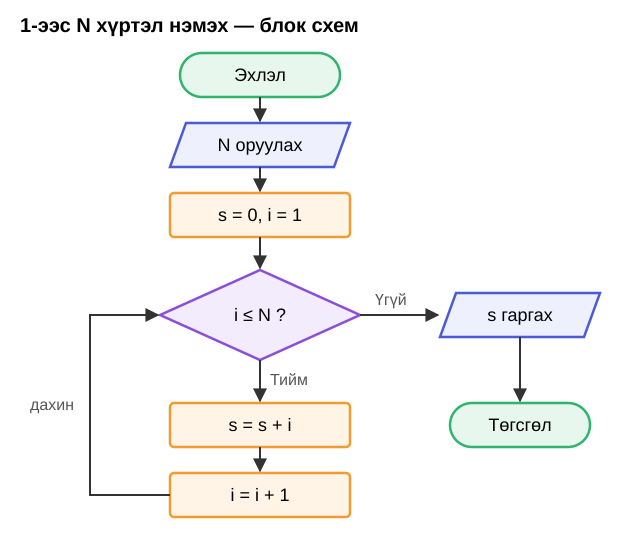

# Хичээл 10 — Давталт: for

### Өнөөдөр компьютерээр нэг зүйлийг **100 удаа** хийлгэнэ — хэдхэн мөр кодоор.

> Алхам бүр дээр **дарж нээнэ**.

---

<details>
<summary><b>0. Бэлтгэл</b></summary>

<br>

1. `js-10` хавтас үүсгээд VSCode-д нээ (**Open Folder**).
2. [index.html](index.html), [main.js](main.js)-ийг татаж аваад (**Download raw file**) хавтсандаа хий.
3. `index.html`-ийг браузерт нээ → **F12** → **Console**. 1-ээс 5 хүртэл тоо гарч байна уу?

Код засах бүрт: **Ctrl+S** → **F5**.

</details>

---

<details>
<summary><b>1. Блок схем — буцах сум</b></summary>

<br>

Ромбо **Тийм** бол доош ажиллаад **буцаж** ромбо руу ирнэ. **Үгүй** болтол давтана.



</details>

---

<details>
<summary><b>2. for</b></summary>

<br>

```js
let n = 3;
let s = 0;

for (let i = 1; i <= n; i++) {
  s = s + i;
}

console.log(s); // 6
```

| Хэсэг | Утга | Блок схем |
| ----- | ---- | --------- |
| `let i = 1` | 1-ээс эхэл | s = 0, i = 1 |
| `i <= n` | n хүртэл | ромбо |
| `i++` | 1-ээр нэм | i = i + 1 |
| `{ s = s + i }` | давтах үйлдэл | s = s + i |

`n = 3` үед алхам алхмаар:

| Удаа | `i` | `s` |
| ---- | --- | --- |
| эхэнд | 1 | 0 |
| 1 | 1 | 1 |
| 2 | 2 | 3 |
| 3 | 3 | 6 |
| `i = 4` → `4 <= 3` худал → зогсоно | | **6** |

> **Хуудас гацвал** давталт тань хэзээ ч зогсохгүй байна (`i++`-ийн оронд `i--` г.м.). Табаа хаагаад кодоо засаад дахин нээ.

</details>

---

<details>
<summary><b>3. Хуримтлагч — тоо ч, текст ч</b></summary>

<br>

Цуглуулах хувьсагчаа давталтаас **өмнө** үүсгэ.

| Юу цуглуулах | Эхлэх утга | Давталт дотор |
| ------------ | ---------- | ------------- |
| Нийлбэр | `let s = 0` | `s = s + i` |
| Үржвэр | `let u = 1` | `u = u * i` |
| Тоо (хэд вэ) | `let too = 0` | `too = too + 1` |
| Текст | `let t = ""` | `t = t + "⭐"` |

</details>

---

## Дасгал

| Түвшин | Дасгал |
| ------ | ------ |
| Анхан | 1–4 |
| Дунд | 5–7 |
| Ахисан | 8, Бонус |

Бүх дасгалыг `main.js`-д, `// Дасгал N` мөрийн доор бич. Хувьсагчийн нэр дасгал бүрт **өөр** байх ёстой — доор өгсөн нэрийг ашигла. Утгыг нь өөрчилж шалга.

---

<details>
<summary><b>Дасгал 1 — 1-ээс N хүртэл нэмэх</b> · Анхан · хамт</summary>

<br>

**Даалгавар:** `n` хувьсагчийн утга хүртэлх бүх тоог (1 + 2 + … + n) нэмж, нийлбэрийг Console-д гарга.

| Оролт | Гаралт |
| ----- | ------ |
| `n = 5` | 15 |
| `n = 1` | 1 |
| `n = 100` | 5050 |

2-р алхмын кодоор, блок схемтэй харьцуулан хамт бичнэ.

</details>

---

<details>
<summary><b>Дасгал 2 — Одод</b> · Анхан</summary>

<br>

**Даалгавар:** `od` хувьсагчид хэдэн тоо байна, тэр тооны ⭐-ийг **нэг мөрөнд** Console-д гарга.

| Оролт | Гаралт |
| ----- | ------ |
| `od = 3` | ⭐⭐⭐ |
| `od = 1` | ⭐ |
| `od = 5` | ⭐⭐⭐⭐⭐ |

<details>
<summary>Зөвлөгөө</summary>

<br>

`let t = "";` хоосон текстээс эхэлж, давталт дотор `t = t + "⭐"`. Давталтын **дараа** `console.log(t)`.

</details>

</details>

---

<details>
<summary><b>Дасгал 3 — Тоолох</b> · Анхан</summary>

<br>

**Даалгавар:** Пуужин хөөрөхийн өмнө тоолдог шиг `ehlel` хувьсагчаас 1 хүртэл **буурч** тоолоод, хамгийн сүүлд `Хөөрлөө!` гэж нэг мөрөнд гарга.

| Оролт | Гаралт |
| ----- | ------ |
| `ehlel = 5` | 5 4 3 2 1 Хөөрлөө! |
| `ehlel = 3` | 3 2 1 Хөөрлөө! |

<details>
<summary>Зөвлөгөө</summary>

<br>

Давталт буурч болно: `let i = ehlel` → `i >= 1` → `i--`. Тоо бүрийн араас зай `" "` нэм.

</details>

</details>

---

<details>
<summary><b>Дасгал 4 — Тэгш тоонууд</b> · Анхан</summary>

<br>

**Даалгавар:** 1-ээс `hyazgaar` хүртэлх тоонуудын дотор **хэдэн** тэгш тоо байгааг тоолж гарга.

| Оролт | Гаралт | Яагаад |
| ----- | ------ | ------ |
| `hyazgaar = 10` | 5 | 2, 4, 6, 8, 10 |
| `hyazgaar = 7` | 3 | 2, 4, 6 |
| `hyazgaar = 1` | 0 | |

<details>
<summary>Зөвлөгөө</summary>

<br>

Давталт дотор Хичээл 9-ийн `if`: `let tegsh = 0;`-ээс эхэл. `i % 2 === 0` бол `tegsh = tegsh + 1`.

</details>

</details>

---

<details>
<summary><b>Дасгал 5 — Үржвэрийн хүснэгт</b> · Дунд</summary>

<br>

**Даалгавар:** `too` хувьсагчийн үржвэрийн хүснэгтийг 1-ээс 10 хүртэл, **мөр бүрт нэг** үржвэр гарга.

`too = 3` үед:

```
3 x 1 = 3
3 x 2 = 6
...
3 x 10 = 30
```

<details>
<summary>Зөвлөгөө</summary>

<br>

Давталт **дотор** `console.log` бич — тэгвэл мөр бүр тусдаа гарна. Текст ба тоог `+`-ээр нийлүүл (Хичээл 8).

</details>

</details>

---

<details>
<summary><b>Дасгал 6 — Факториал</b> · Дунд</summary>

<br>

**Даалгавар:** `f` хувьсагчийн факториалыг (1 × 2 × … × f) олж гарга.

| Оролт | Гаралт |
| ----- | ------ |
| `f = 5` | 120 |
| `f = 1` | 1 |
| `f = 10` | 3628800 |

<details>
<summary>Зөвлөгөө</summary>

<br>

Нийлбэр 0-ээс эхэлдэг. Үржвэр хэдээс эхлэх вэ? (3-р алхам)

</details>

</details>

---

<details>
<summary><b>Дасгал 7 — Хуримтлал</b> · Дунд</summary>

<br>

**Даалгавар:** Сар бүр `sarBur` төгрөг хадгална. `sar` сарын турш сар бүрийн **нийт** хуримтлалыг мөр бүрт гарга.

`sarBur = 40000`, `sar = 3` үед:

```
1-р сар: 40000
2-р сар: 80000
3-р сар: 120000
```

<details>
<summary>Зөвлөгөө</summary>

<br>

`let mungu = 0;`-ээс эхэл. Давталт дотор `mungu = mungu + sarBur`, дараа нь `console.log(i + "-р сар: " + mungu)`.

</details>

</details>

---

<details>
<summary><b>Дасгал 8 — Анхны тоо</b> · Ахисан</summary>

<br>

**Даалгавар:** `x` хувьсагч анхны тоо бол `Анхны тоо`, үгүй бол `Анхны биш` гэж гарга.

Анхны тоо = **яг 2** хуваагчтай: 1 ба өөрөө. (1 нь анхны биш.)

| Оролт | Гаралт |
| ----- | ------ |
| `x = 7` | Анхны тоо |
| `x = 2` | Анхны тоо |
| `x = 9` | Анхны биш |
| `x = 1` | Анхны биш |
| `x = 97` | Анхны тоо |

<details>
<summary>Зөвлөгөө</summary>

<br>

1-ээс `x` хүртэлх тоо бүрээр хуваагдах уу? Хуваагдвал `huvaagch`-ийг 1-ээр нэм. Давталтын дараа `huvaagch === 2` эсэхийг шалга.

</details>

</details>

---

<details>
<summary><b>Бонус — 3 эсвэл 5</b> · Ахисан</summary>

<br>

**Даалгавар:** 1-ээс `dees` хүртэлх тоонуудаас **3-т эсвэл 5-д** хуваагдах тоонуудын нийлбэрийг гарга.

| Оролт | Гаралт | Яагаад |
| ----- | ------ | ------ |
| `dees = 10` | 33 | 3 + 5 + 6 + 9 + 10 |
| `dees = 5` | 8 | 3 + 5 |
| `dees = 100` | 2418 | |

<details>
<summary>Зөвлөгөө</summary>

<br>

Давталт дотор `if` + Хичээл 9-ийн `||`.

</details>

</details>

---

<details>
<summary><b>Гэрийн даалгавар</b></summary>

<br>

| #   | Юу хийх | ✔️  |
| --- | ------- | --- |
| 1   | Дасгал 1–6 дуусга | ⬜  |
| 2   | Дасгал 7–8, Бонус (заавал биш) | ⬜  |

</details>
