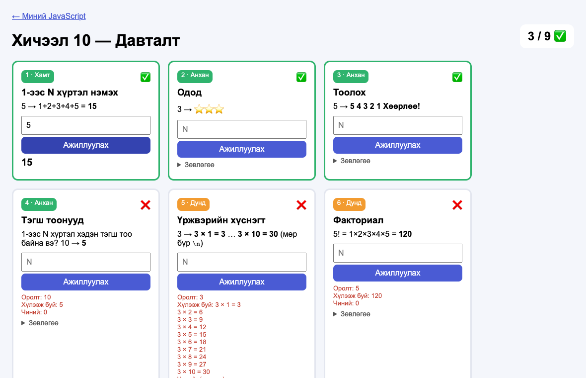

# Хичээл 10

### Өнөөдөр компьютерээр нэг зүйлийг **100 удаа** хийлгэнэ — хэдхэн мөр кодоор.

> **Агуулга:** _(төлөвлөсөн)_ Блок схемийн буцах сум (давталт), `for`, `while`, хуримтлагч хувьсагч (`s = s + i`), давталт дотор `if`. `js-10.html`-ийн 9 карт. Build Battle — өөрийн карт зохиох.



---

> Алхам бүр дээр **дарж нээнэ**.

---

<details>
<summary><b>1. Файлаа бэлд</b></summary>

<br>

[js-10.html](js-10.html)-ийг `my-first-web/`-д хуулж нээ. **0 / 9** гарч байна уу?

</details>

---

<details>
<summary><b>2. Блок схем — буцах сум</b></summary>

<br>

Ромбо **Тийм** бол доош ажиллаад **буцаж** ромбо руу ирнэ. **Үгүй** болтол давтана.


</details>

---

<details>
<summary><b>3. for</b></summary>

<br>

```js
function niilber(n) {
  let s = 0;
  for (let i = 1; i <= n; i++) {
    s = s + i;
  }
  return s;
}
```

| Хэсэг | Утга | Блок схем |
| ----- | ---- | --------- |
| `let i = 1` | 1-ээс эхэл | s = 0, i = 1 |
| `i <= n` | n хүртэл | ромбо |
| `i++` | 1-ээр нэм | i = i + 1 |
| `{ s = s + i }` | давтах үйлдэл | s = s + i |

`n = 3` үед алхам алхмаар:

| Удаа | `i` | `s` |
| ---- | --- | --- |
| эхэнд | 1 | 0 |
| 1 | 1 | 1 |
| 2 | 2 | 3 |
| 3 | 3 | 6 |
| `i = 4` → `4 <= 3` худал → зогсоно | | **6** |

</details>

---

<details>
<summary><b>4. Хуримтлагч — тоо ч, текст ч</b></summary>

<br>

| Юу цуглуулах | Эхлэх утга | Давталт дотор |
| ------------ | ---------- | ------------- |
| Нийлбэр | `let s = 0` | `s = s + i` |
| Үржвэр | `let u = 1` | `u = u * i` |
| Тоо (хэд вэ) | `let too = 0` | `too = too + 1` |
| Текст | `let t = ""` | `t = t + "⭐"` |

</details>

---

<details>
<summary><b>5. while — хэдэн удаа гэдгийг мэдэхгүй үед</b></summary>

<br>

```js
let mungu = 0;
let sar = 0;
while (mungu < 300000) {
  mungu = mungu + 40000;
  sar = sar + 1;
}
// sar = 8
```

`for` — хэдэн удаа гэдгийг **мэднэ**. `while` — нөхцөл худал болтол.

</details>

---

<details>
<summary><b>6. Бие даан: 2–9</b></summary>

<br>

| Түвшин | Карт |
| ------ | ---- |
| Анхан | 2–4 |
| Дунд | 5–7 |
| Ахисан | 8–9 — блок схемээр зур |

> **Хуудас гацвал** давталт тань хэзээ ч зогсохгүй байна (`i--` гэх мэт). Табаа хаагаад кодоо засаад дахин нээ.

</details>

---

<details>
<summary><b>7. Build Battle — өөрийн карт 🏆</b></summary>

<br>

Давталттай **өөрийн бодлого** зохиож, `js-10.html`-д карт болгон нэм.

1. Карт 9-ийн `<div class="kart" …> … </div>`-ийг хуулж, сүүлийн картын доор тавь.
2. Соль:

```html
<div class="kart" data-fn="minii" data-test='[[[3], 6], [[5], 15]]'>
  <div class="deed"><span class="tuvshin ahisan">Миний бодлого</span><span class="tuluv"></span></div>
  <h3>Гарчиг</h3>
  <p>Тайлбар: 3 → 6</p>
  <input type="number" placeholder="N">
  <button>Ажиллуулах</button>
  <p class="hariu"></p>
  <p class="tailbar"></p>
</div>
```

3. `<script>` дотор функцээ бич: `function minii(n) { … }`.

| Хэсэг | Утга |
| ----- | ---- |
| `data-fn` | Функцийн нэр |
| `data-test` | `[[[оролт], хариу], [[оролт], хариу]]` — 2+ тест |

Санаа: N хүртэлх 3-т хуваагдах тоонууд · N давхар шат 🧱 · N хүртэл тоолоод 5-д хуваагдвал "Бам!".

Ангиараа дэлгэц бүрийг тойрч үзээд хамгийн сонирхолтой 3 картад санал өгнө.

</details>

---

<details>
<summary><b>8. Portfolio-д нэмэх</b></summary>

<br>

1. `js.html`-д хайрцаг нэм: дугаар **10**, линк `js-10.html`, гарчиг **Давталт**, "Сурсан: for, while, хуримтлагч".
2. Netlify → **Deploys** → `my-first-web`-ээ дахин чир.

</details>

---

<details>
<summary><b>Гэрийн даалгавар</b></summary>

<br>

| #   | Юу хийх | ✔️  |
| --- | ------- | --- |
| 1   | `js-10.html` — бүх карт ✅ (дор хаяж 1–6) | ⬜  |
| 2   | Өөрийн картаа дуусгаж ✅ гаргах | ⬜  |
| 3   | 8-р алхам: `js.html` + Netlify. Картынхаа screenshot-ыг Discord-д тавь | ⬜  |

</details>
