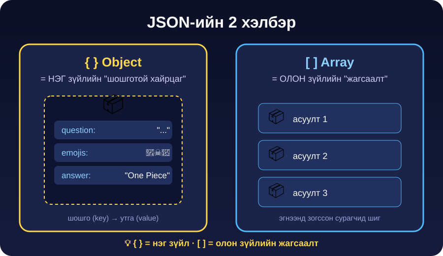
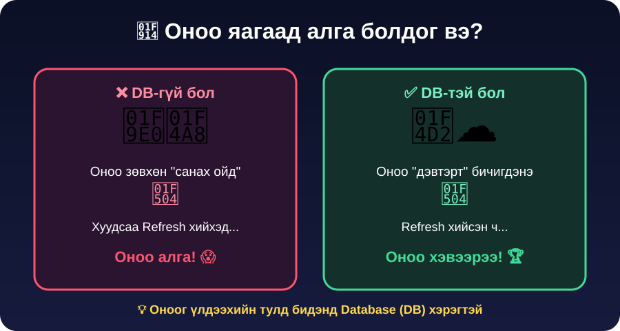
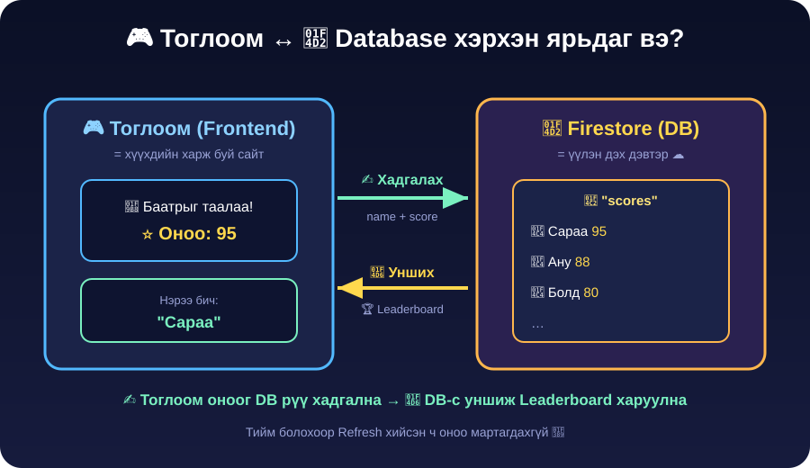
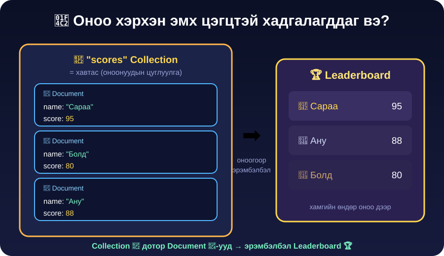

# Хичээл 13 — Anime Guess: JSON дата + Leaderboard

> **Агуулга:** _(хичээл орсны дараа бөглөнө)_

### Асуултын датагаа **өөрөө** бэлдэж, 3 горимтой таавар тоглоом хийгээд, оноог **Firestore**-д хадгалж Leaderboard гаргана.

[Жишээ тоглоом](https://ai.studio/apps/c075aff4-289c-45c8-a050-9207f9afe5ac) · Хэрэгсэл: VSCode · [JSONLint](https://jsonlint.com) · ChatGPT · AI Studio

| #   | Алхам                         | Хугацаа |
| --- | ----------------------------- | ------- |
| 1   | Массив → object               | 15 мин  |
| 2   | Эхний 3 асуултаа өөрөө бичих  | 20 мин  |
| 3   | ChatGPT-аар 10–15 асуулт нэмэх | 15 мин  |
| 4   | Тоглоомоо үүсгэх (3 горим)    | 30 мин  |
| 5   | Өөрийн төрөл нэмэх (Sport, Movie…) | 10 мин  |
| 6   | Firestore + Leaderboard       | 30 мин  |

> Алхам бүр дээр **дарж нээнэ**.

---

<details>
<summary><b>1. Массив → object</b></summary>

<br>

Хичээл 11-д 2 массив зэрэгцүүлсэн: `anime[i]` ↔ `emoji[i]`. Одоо нэг асуултын **бүх мэдээллийг нэг хайрцагт** хийнэ.



| Хэлбэр       | Гэдэг нь               |
| ------------ | ---------------------- |
| `{ }` object | **Нэг** асуулт         |
| `[ ]` array  | **Олон** асуултын жагсаалт |

```json
[
  {
    "emoji": "🍥🍜🦊",
    "image": "https://upload.wikimedia.org/...",
    "answer": "Naruto",
    "options": ["Naruto", "Bleach", "One Piece", "Death Note"]
  }
]
```

| Талбар    | Аль горимд        |
| --------- | ----------------- |
| `emoji`   | Emoji горим       |
| `image`   | Anime горим (дүр зураг) |
| `answer`  | Зөв хариулт       |
| `options` | 4 сонголт (зөв хариулт **дотор нь**) |

<details>
<summary>JSON-ийн дүрэм</summary>

- key болон текст `" "` дотор (`' '` биш)
- талбар хооронд `,` · **сүүлчийнх `,`-гүй**
- нээсэн `{ [` хаалтаа заавал хаа

</details>

</details>

---

<details>
<summary><b>2. Эхний 3 асуултаа өөрөө бичих</b></summary>

<br>

1. VSCode-д `data.json` файл үүсгэ.
2. Дээрх жишээг хуулж, **өөрийн дуртай 3 анимиэр** 3 object бич.
3. `image` — тухайн анимийн **дүр зураг (scene)**. Нэр нь бичигдсэн poster биш.
4. [JSONLint](https://jsonlint.com)-д буулгаад **Validate** → ногоон болтол зас.

<details>
<summary>Зургийн хаяг яаж авах вэ?</summary>

1. Google Images / [Fandom](https://www.fandom.com) / [Wikipedia](https://www.wikipedia.org)-аас зураг ол.
2. Зургийг томруулаад **баруун товч → Copy image address**.
3. Шинэ tab-д paste → **зөвхөн зураг** гарвал зөв.

Ажиллахгүй бол зургаа татаж аваад дараа AI Studio-д upload хий.

</details>

**Шалга:** 3 асуулт · JSONLint ногоон · зураг бүр шинэ tab-д нээгдэнэ.

</details>

---

<details>
<summary><b>3. ChatGPT-аар 10–15 асуулт нэмэх</b></summary>

<br>

ChatGPT-д:

```text
Аниме таавар тоглоомын data.json-д асуулт нэмээч.
Миний 3 асуултыг яг хэвээр нь эхэнд үлдээгээд, ижил бүтэцтэй 12 асуулт нэм.
- emoji: тухайн анимийг илэрхийлэх 3 emoji
- image: тухайн анимийн дүр зураг (нэр бичигдээгүй). Хаягаа мэдэхгүй бол ""
- answer: анимийн англи нэр
- options: 4 сонголт, зөв хариулт дотор нь, байрлал холилдсон
Зөвхөн алдартай аниме. Давхардуулахгүй. Зөвхөн JSON array буцаа.

[МИНИЙ 3 АСУУЛТ — data.json-ОО ЭНД БУУЛГА]
```

Гарсныг `data.json`-д солиод JSONLint-ээр шалга.

> **AI эндүүрдэг.** Emoji тохирч байна уу? Зөв хариулт `options`-д байна уу? Зургийн хаяг ажиллаж байна уу — ажиллахгүйг өөрөө соль эсвэл `""` үлдээ.

</details>

---

<details>
<summary><b>4. Тоглоомоо үүсгэх (3 горим)</b></summary>

<br>

1. [Жишээ тоглоом](https://ai.studio/apps/c075aff4-289c-45c8-a050-9207f9afe5ac) эсвэл таалагдсан тоглоомын загварыг **screenshot** ав (`Win+Shift+S`).
2. Portfolio-гоо AI Studio-д нээ → screenshot-оо хавсарга → доорх prompt + `data.json`-оо буулга.

```text
Миний portfolio сайтад "Тоглоомууд" хэсэг нэм. Хавсаргасан screenshot-ын загвартай төстэй хий.

ТОГЛООМЫН ЖАГСААЛТ:
- "Тоглоомууд" хэсэгт тоглоом бүр нэг карт (зураг, нэр, "Тоглох" товч).
- Эхний тоглоом: "Anime Guess".
- "Тоглох" дарахад тоглоом тусдаа цонхонд (бүтэн дэлгэцийн modal) нээгдэнэ. Баруун дээд буланд "✕ Хаах".
- Дараа нь өөр тоглоом нэмэхэд зөвхөн жагсаалтад нэг карт нэмэгдэхээр хий.

ДАТА:
- Асуултууд "data.json" файлд. Агуулга нь доорх JSON array.
- Тоглох бүрт асуултын дарааллыг холь.

3 ГОРИМ — эхэнд "Ямар горимоор тоглох вэ?" гэж 3 товч гарга:
1. Emoji — "emoji"-г том харуулж, "options"-оос анимийг таалгана.
2. Anime — "image" зургийг бүдэг (blur) харуулж, 3 сек тутам тодруулна. "options"-оос анимийг таалгана.
   "image" хоосон эсвэл ачаалагдахгүй асуултыг энэ горимд алгас.
3. Баатар — баатрын зургийг харуулж нэрийг 4 сонголтоос таалгана.
   Датаг data.json-ийн "characters" хэсэгт тусад нь хадгал. Одоохондоо Luffy, Naruto, Goku 3 баатартай.

ДҮРЭМ:
- Асуулт бүрт [15] секунд. Цаг дуусвал буруу.
- [3] амьтай. Зөв бол +[10] оноо. Оноо, амь, цагийг байнга харуул.
- Зөв бол ногоон, буруу бол улаан болж зөв хариуг харуул.
- Хариулсны дараа тухайн асуултын "image" зургийг (тод) зөв хариутай нь 2 сек харуулаад дараагийн асуулт руу шилж.
- Төгсгөлд оноо + "Дахин тоглох" + "Горим солих" товч.

[data.json-ОО ЭНД БУУЛГА]
```

> `[ ]` доторх тоог өөрийнхөөрөө соль: хугацаа бага, амь цөөн = хэцүү.

**Шалга:** "Тоглоомууд" жагсаалтаас Anime Guess тусдаа цонхонд нээгдэнэ · 3 горим сонгогдоно · асуулт гарна · хариулсны дараа зураг гарна · оноо нэмэгдэнэ · амь хасагдана · тоглоом дуусна. Бүгд ажиллатал цааш бүү яв.

<details>
<summary>Ажиллахгүй бол</summary>

```text
Тоглоом [юу болохгүй байгааг тодорхой бич] байна. Шалгаад засаач.
```

Console-д улаан алдаа байвал хуулж AI-д өг.

</details>

<details>
<summary>AI-ийн кодоос датагаа олох</summary>

AI Studio → **Code** → `data.json`-оо нээ. Гараараа 1 асуулт нэм → тоглоомд гарч байна уу?

> **Код = дүрэм · Дата = агуулга.** Асуулт нэмэхэд код өөрчлөх шаардлагагүй.

</details>

</details>

---

<details>
<summary><b>5. Өөрийн төрөл нэмэх (Sport, Movie…)</b></summary>

<br>

Anime Guess **бүрэн** ажиллаж байвал: **код хэвээр, зөвхөн дата өөр** → шинэ тоглоом.

| Төрөл  | `answer` жишээ             |
| ------ | -------------------------- |
| Sport  | Football, Basketball, Sumo |
| Movie  | Frozen, Shrek, Spider-Man  |
| Хоол   | Бууз, Pizza, Sushi         |
| Амьтан | Арслан, Пингвин, Тэмээ     |

**5.1 Дата** — ChatGPT-д (Алхам 3-ын prompt-ыг төрлөөрөө өөрчил):

```text
"[Sport]" таавар тоглоомын data.json хий. Миний anime data.json-той яг ижил бүтэцтэй 12 асуулт.
- emoji: тухайн [спорт]-ыг илэрхийлэх 3 emoji
- image: тухайн [спорт]-ын зураг (нэр бичигдээгүй). Хаягаа мэдэхгүй бол ""
- answer: нэр
- options: 4 сонголт, зөв хариулт дотор нь, байрлал холилдсон
Давхардуулахгүй. Зөвхөн JSON array буцаа.

[ANIME data.json-ООС 1 АСУУЛТ ЖИШЭЭ БОЛГОЖ БУУЛГА]
```

JSONLint-ээр шалга.

**5.2 Тоглоом** — AI Studio-д:

```text
"Тоглоомууд" жагсаалтад "[Sport Guess]" тоглоом нэм.
Anime Guess-ийн кодыг яг хэвээр ашигла, зөвхөн дата нь өөр.
Датаг "[sport].json" файлд хадгал. Агуулга нь доорх JSON array.
Горим: Emoji, Зураг (2 горим). Баатар горим хэрэггүй.

[sport.json-ОО ЭНД БУУЛГА]
```

> `[ ]` доторхыг өөрийн төрлөөр соль.

**Шалга:** жагсаалтад 2 карт · хоёулаа тусдаа цонхонд нээгдэнэ · Anime Guess эвдрээгүй.

</details>

---

<details>
<summary><b>6. Firestore + Leaderboard</b></summary>

<br>

Хуудсаа Refresh хийхэд оноо алга болдог. Үлдээхийн тулд **Database** хэрэгтэй.



<details>
<summary>Тоглоом ↔ Firestore хэрхэн ажилладаг вэ?</summary>



**Collection** (хавтас) дотор **Document**-ууд (нэг тоглогчийн оноо) байна.



</details>

**6.1 Оноо хадгалах** — AI Studio-д:

```text
Anime Guess тоглоом дуусахад тоглогчийн нэрийг асууж,
нэр + оноо + тоглоом + горим + огноог Firestore-ийн "scores" collection-д хадгал.
Firebase тохируулах алхмыг надад нэг нэгээр нь хэлж өг.
```

> AI-ийн хэлсэн алхмыг (Firebase төсөл үүсгэх, тохиргоо хуулах) **алгасахгүй** дага.

**6.2 Leaderboard:**

```text
"Leaderboard" товч нэм. "scores"-оос оноогоор их → бага эрэмбэлж ТОП 10-ыг харуул.
Тоглоом бүрээр (Anime Guess, [Sport Guess]), дотор нь горимоор шүүдэг таб байг. 1–3-р байрыг онцолж харуул.
```

**Шалга:** тоглоод нэрээ бич → Refresh → Leaderboard-д нэр чинь байна уу? Найзынхаа утаснаас тоглуулаад нэр нь гарч байна уу?

> Нэрийн оронд **хочоо** бич. Бүтэн нэр, сургууль, утас — болохгүй.

<details>
<summary>Оноо хадгалагдахгүй бол</summary>

```text
Тоглоом дуусахад оноо Firestore-д хадгалагдахгүй байна. Шалгаад засаач.
```

Console-ийн улаан алдааг хуулж AI-д өг.

</details>

</details>

---

<details>
<summary><b>Гэрийн даалгавар</b></summary>

<br>

| #   | Юу хийх | ✔️  |
| --- | ------- | --- |
| 1   | **Баатар горим:** эхний 3 баатраа өөрөө бич (`image`, `answer`, `options`, `anime`) → ChatGPT-аар 10 нэмүүл (Алхам 3-ын prompt) | ⬜  |
| 2   | AI Studio-д: _"data.json-ийн "characters"-ийг доорх JSON-оор соль."_ + JSON-оо буулга | ⬜  |
| 3   | Найз, гэрийнхнээ тоглуулж Leaderboard-д 5+ хүн оруул | ⬜  |
| 4   | "Тоглоомууд" жагсаалтад 3 дахь төрлөө нэм (Алхам 5) | ⬜  |

</details>
