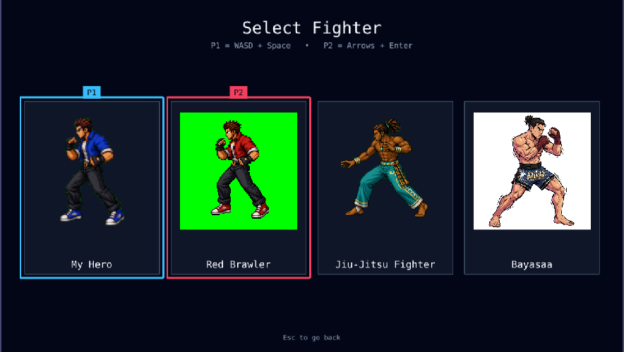
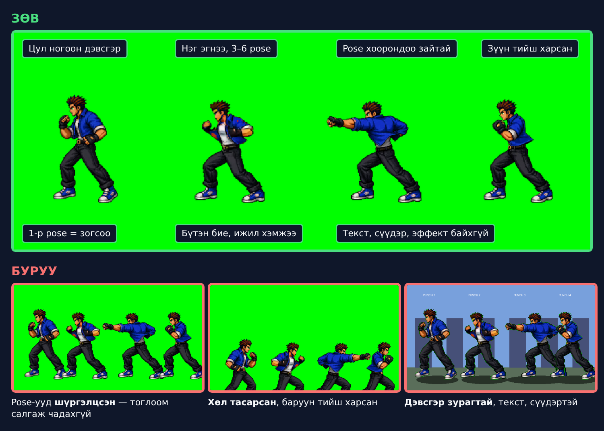

# Хичээл 16 — Street Fighter 1: Өөрийн дүрээ бүтээх

> **Агуулга:** _(хичээл орсны дараа бөглөнө)_

### Бэлэн тулааны тоглоомыг AI Studio-д оруулаад, **өөрийн дүрээ** Gemini-ээр зуруулж тоглоомдоо нэмнэ.

[Эх видео](https://www.youtube.com/watch?v=rLLBq8E18SA) · [Тоглоомын код](https://github.com/bayasgalan0912/vibe-fighter) · Хэрэгсэл: [AI Studio](https://aistudio.google.com) · [Gemini](https://gemini.google.com)

| #   | Алхам                              | Хугацаа |
| --- | ---------------------------------- | ------- |
| 1   | Тоглоомоо AI Studio-д оруулж тоглох | 15 мин  |
| 2   | Жишээ дүр нэмж турших              | 15 мин  |
| 3   | Дүрээ зохиох — эх зураг            | 20 мин  |
| 4   | Sheet-ийн 7 дүрэм                  | 10 мин  |
| 5   | idle, walk, punch зуруулах         | 35 мин  |
| 6   | Дүрээ тоглоомдоо оруулах           | 15 мин  |

> Алхам бүр дээр **дарж нээнэ**.

**Гол санаа:** зураг засахгүй, код бичихгүй. **Зураг → хавтас → 1 мөр.**

---

<details>
<summary><b>1. Тоглоомоо AI Studio-д оруулж тоглох</b></summary>

<br>

1. [AI Studio](https://aistudio.google.com) → **Build** → **Import from GitHub**.
2. Хаяг: `https://github.com/bayasgalan0912/vibe-fighter`
3. Preview гарсны дараа **Play** → **1v1** → арена → дүрээ сонго.
4. Хажуудаа суусан хүнтэйгээ 1 раунд тогло.

| Үйлдэл         | Тоглогч 1 | Тоглогч 2 |
| -------------- | --------- | --------- |
| Явах, үсрэх, суух | `W A S D` | сумтай товч |
| Хөнгөн цохилт  | `F`       | `,`       |
| Хүнд цохилт    | `G`       | `.`       |
| Хамгаалах      | `C`       | `/`       |
| Special        | `V`       | `L`       |
| Дүр сонгох     | `A D` + `Space` | `← →` + `Enter` |

<details>
<summary>Import товч байхгүй бол</summary>

Багшийн өгсөн апп-ын линкийг нээгээд **Remix** (хуулбарлах) дар.

</details>

</details>

---

<details>
<summary><b>2. Жишээ дүр нэмж турших</b></summary>

<br>

Өөрийн дүрээ зурахаас өмнө **бэлэн 6 зургаар** яаж ажилладгийг үзнэ.

1. [`jishee/`](jishee) хавтасны 6 зургийг тат: `idle` `walk` `punch` `kick` `hit` `ko`.
2. AI Studio → **Code** → `public/assets/` дотор **`my-hero`** хавтас үүсгээд 6 зургаа оруул.
3. `src/game/myFighters.ts` файлыг нээгээд нэг мөр нэм:

```ts
export const MY_FIGHTERS: MyFighter[] = [
  { id: 'my-hero', name: 'My Hero' },
];
```

4. Preview-г дахин ачаал → **Select Fighter** дээр хамгийн эхэнд гарна.



| Талбар | Утга |
| ------ | ---- |
| `id`   | хавтасны нэр — **яг ижил** байна |
| `name` | тоглоомд харагдах нэр |

<details>
<summary>Тоглоом зургийг яаж ойлгодог вэ?</summary>

Тоглоом эхлэхдээ зураг бүрийг өөрөө боловсруулна:

1. Ногоон дэвсгэрийг арилгана.
2. Pose-уудыг **хоорондох зайгаар** нь салгана.
3. Бүгдийг ижил өндөртэй болгож, хөлийг нэг шугамд тавина.

Тиймээс чи зургаа тайрах, жижигрүүлэх, дэвсгэр арилгах шаардлагагүй.

</details>

</details>

---

<details>
<summary><b>3. Дүрээ зохиох — эх зураг</b></summary>

<br>

Эхлээд **ганц** зураг — дүрийн "паспорт". Дараагийн бүх зургийг үүнээс гаргана.

| Зам | Жишээ |
| --- | ----- |
| Дуртай дүр | Naruto, Goku, Spider-Man |
| Өөрөө | өөрийн зургаа хавсаргаад pixel art тулаанч болгох |
| Зохиох | бөх, харваач, кибер нинжа, тулаанч муур |

[Gemini](https://gemini.google.com) → **Create image**:

```text
Create a 2D fighting game character in 16-bit pixel art style.
Character: [ДҮРЭЭ ЭНД ТАЙЛБАРЛА — үс, хувцас, өнгө]
One character, full body, side view, facing LEFT, fighting stance.
Plain solid green background (#00FF00).
No text, no shadow, no effects.
```

5. Таалагдсан зургаа тат → `eh-zurag.png` гэж хадгал.

| Шалгах | |
| ------ | --- |
| Бүтэн бие (толгойноос хөл хүртэл) | ☐ |
| Зүүн тийш харсан | ☐ |
| Хувцсанд **ногоон өнгө байхгүй** | ☐ |

> Ногоон хувцастай дүр бол prompt-ын `green (#00FF00)`-г `magenta (#FF00FF)` болго.

<details>
<summary>Дүрэм</summary>

- Бусдын (найз, багш) зургийг **зөвшөөрөлгүй** дүр болгохгүй.
- Цус, шарх зуруулахгүй.
- Дуртай дүр (Naruto г.м.) ашиглавал "Fan-made" гэж бич — зохиогч нь өөр хүн.

</details>

</details>

---

<details>
<summary><b>4. Sheet-ийн 7 дүрэм</b></summary>

<br>

**Sprite sheet** = нэг хөдөлгөөний pose-уудыг нэг зурагт эгнүүлсэн зураг. Тоглоом тэднийг ээлжлэн харуулж хөдөлгөнө.



| #   | Дүрэм | Яагаад |
| --- | ----- | ------ |
| 1   | Цул **ногоон** дэвсгэр | тоглоом өөрөө арилгана |
| 2   | **Нэг эгнээ**, 3–6 pose | зүүнээс баруун тийш тоглуулна |
| 3   | Pose хоорондоо **зайтай** | зайгаар нь салгадаг |
| 4   | **Бүтэн бие**, ижил хэмжээ | тасарсан хөл = гажсан хөдөлгөөн |
| 5   | **Зүүн** тийш харсан | тоглоом өөрөө эргүүлнэ |
| 6   | 1-р pose = **зогсоо** | дүрийн хэмжээг үүгээр тааруулна |
| 7   | Текст, сүүдэр, эффект **байхгүй** | дүрийн хэсэг болчихно |

</details>

---

<details>
<summary><b>5. idle, walk, punch зуруулах</b></summary>

<br>

1. Gemini-д **шинэ chat** нээ → `eh-zurag.png`-ээ **хавсарга**.
2. Доорх prompt-ын `[ХӨДӨЛГӨӨН]`-ийг хүснэгтээс сольж явуул.

```text
Use this exact character: same face, same clothes, same colors.
Make a sprite sheet of 4 poses in ONE horizontal row, with empty space between the poses.
Animation: [ХӨДӨЛГӨӨН]
Every pose: full body, same size, side view, facing LEFT, feet on the same ground line.
Plain solid green background (#00FF00).
No text, no numbers, no shadow, no effects. Wide 16:9 image.
```

| Файл        | `[ХӨДӨЛГӨӨН]` |
| ----------- | ------------- |
| `idle.png`  | `standing ready and breathing. Pose 1 normal stance, pose 2 chest slightly up, pose 3 normal, pose 4 slightly down` |
| `walk.png`  | `walking forward, 4 steps of a walk cycle. Pose 1 normal stance` |
| `punch.png` | `a punch. Pose 1 normal stance, pose 2 fist pulled back, pose 3 arm fully straight punching forward, pose 4 arm coming back` |

3. Зураг бүрийг 4-р алхмын **7 дүрмээр** шалга → татаж, хүснэгтийн нэрээр хадгал.

| Буруу гарвал | Тэр chat-даа бич |
| ------------ | ---------------- |
| Дүр өөр хүн болсон | `Keep the exact same character as the attached image. Change only the pose.` |
| Pose шүргэлцсэн | `Add more empty space between the poses.` |
| Баруун тийш харсан | `Make every pose face LEFT.` |
| Текст, сүүдэр орсон | `Remove all text and shadows. Only the character on plain green.` |

> Зураг үүсгэх **limit**-тэй. Шаардлагаа нэг мессежид багтаа, гарсан зургаа тэр даруй хадгал.

</details>

---

<details>
<summary><b>6. Дүрээ тоглоомдоо оруулах</b></summary>

<br>

2-р алхамтай **яг адил**, зөвхөн өөрийн нэрээр.

1. `public/assets/` дотор дүрийнхээ хавтсыг үүсгэ. Нэр: **англи, жижиг үсэг, зайгүй** (`naruto`, `cyber-ninja`).
2. `idle.png`, `walk.png`, `punch.png`-ээ оруул.
3. `src/game/myFighters.ts`-д мөр нэм:

```ts
export const MY_FIGHTERS: MyFighter[] = [
  { id: 'naruto', name: 'Naruto' },
  { id: 'my-hero', name: 'My Hero' },
];
```

4. Preview-г дахин ачаалж, дүрээрээ тогло.


> `kick`, `hit`, `ko` зураг хараахан байхгүй — тоглоом оронд нь `punch`, `idle`-г ашиглана. Дараагийн хичээлд нэмнэ.

**Шалгах:** `F12` → Console. Дүр бүрд нэг мөр гарна:

```text
[my-fighter] naruto: idle 4, walk 4, punch 4, kick -, hit -, ko -, jump -, crouch -, block -, special -
```

| Тэмдэг | Утга |
| ------ | ---- |
| `4`    | 4 pose олсон |
| `-`    | зураг олдоогүй — хавтас, файлын нэрээ шалга |

</details>

---

<details>
<summary><b>Гацвал</b></summary>

<br>

| Асуудал | Шийдэл |
| ------- | ------ |
| Дүр жагсаалтад гарахгүй | `id` ба хавтасны нэр **яг ижил** үү? Том үсэг, зай байгаа юу? |
| Саарал "?" дүр гарсан | `idle.png` олдоогүй — нэр, хавтсаа шалга |
| Нэг frame-д 2 бие | Pose шүргэлцсэн — дахин зуруул. Эсвэл `frames: { punch: 4 }` нэм |
| Дүрийн эргэн тойронд ногоон хүрээ | Дэвсгэр цул ногоон биш — дахин зуруул |
| Дүрийн хэсэг алга болсон | Хувцас дэвсгэртэй ижил өнгөтэй — magenta дэвсгэрээр зуруул |
| Дүр буруу тийш харна | `{ id: 'naruto', name: 'Naruto', flip: true }` |

</details>

<details>
<summary><b>Гэрийн даалгавар</b></summary>

<br>

1. Амжаагүй бол `idle`, `walk`, `punch`-аа дуусга.
2. 5-р алхмын prompt-оор `kick.png` зуруулж үз:
   `a high kick. Pose 1 normal stance, pose 2 knee lifted, pose 3 leg fully straight kicking forward, pose 4 leg coming down`
3. Дүрийнхээ **special** цохилтыг бод — нэр, ямар хөдөлгөөн.

</details>
