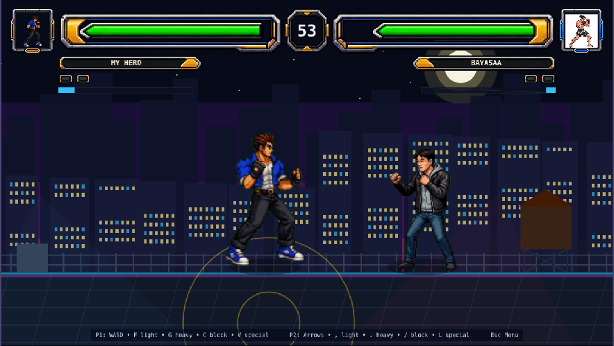

# Хичээл 16 — Street Fighter 1: Баатраа нэмэх

> **Агуулга:** _(хичээл орсны дараа бөглөнө)_

### Бэлэн тулааны тоглоомыг AI Studio-д оруулаад, **алдартай баатар** болон **өөрийгөө** тоглоомдоо нэмнэ.

[Эх видео](https://www.youtube.com/watch?v=rLLBq8E18SA) · [Тоглоомын код](https://github.com/bayasgalan0912/vibe-fighter) · Хэрэгсэл: [AI Studio](https://aistudio.google.com) · [Gemini](https://gemini.google.com)

| #   | Алхам                                  | Хугацаа |
| --- | -------------------------------------- | ------- |
| 1   | Тоглоомоо AI Studio-д оруулж тоглох     | 10 мин  |
| 2   | Жишээ дүр нэмэх                        | 10 мин  |
| 3   | Sheet-ийн 7 дүрэм                      | 10 мин  |
| 4   | Алдартай баатар — AI Studio-оор шууд    | 15 мин  |
| 5   | Өөрийгөө баатар болгох — эх зураг       | 20 мин  |
| 6   | idle, walk, punch зуруулах             | 35 мин  |
| 7   | Өөрийгөө тоглоомдоо оруулах            | 15 мин  |

> Алхам бүр дээр **дарж нээнэ**.

| Баатар | Зургийг хэн зурах вэ | Хаана |
| ------ | -------------------- | ----- |
| Алдартай (Naruto, Goku…) | AI Studio өөрөө | 4-р алхам |
| **Чи өөрөө** | Gemini, чиний зургаас | 5–7-р алхам |

---

<details>
<summary><b>1. Тоглоомоо AI Studio-д оруулж тоглох</b></summary>

<br>

1. [AI Studio](https://aistudio.google.com) → **Build** → **Import from GitHub**.
2. Хаяг: `https://github.com/bayasgalan0912/vibe-fighter`
3. Preview гарсны дараа **Play** → **1v1** → арена → дүрээ сонго.
4. Хажуудаа суусан хүнтэйгээ 1 раунд тогло.

| Үйлдэл         | Тоглогч 1 | Тоглогч 2 |
| -------------- | --------- | --------- |
| Явах, үсрэх, суух | `W A S D` | сумтай товч |
| Хөнгөн цохилт  | `F`       | `,`       |
| Хүнд цохилт    | `G`       | `.`       |
| Хамгаалах      | `C`       | `/`       |
| Special        | `V`       | `L`       |
| Дүр сонгох     | `A D` + `Space` | `← →` + `Enter` |

</details>

---

<details>
<summary><b>2. Жишээ дүр нэмэх</b></summary>

<br>

Бэлэн 6 зургаар баатар яаж нэмэгддэгийг үзнэ.

1. [`jishee/`](jishee) хавтасны 6 зургийг тат: `idle` `walk` `punch` `kick` `hit` `ko`.
2. AI Studio-ийн chat-д 6 зургаа **хавсаргаад** бич:

```text
ADD_CHARACTER.md-г уншаад дага.
Хавсаргасан 6 зургаар баатар нэм. id: my-hero, нэр: My Hero.
Зургуудыг өөрчлөхгүй, файлын нэрээр нь хадгал.
```

3. **Select Fighter** дээр хамгийн эхэнд гарна. Тоглож үз.


<details>
<summary>AI Studio юу хийсэн бэ?</summary>

| Хийсэн зүйл | Хаана |
| ----------- | ----- |
| 6 зургийг хадгалсан | `public/assets/my-hero/` |
| 1 мөр нэмсэн | `src/game/myFighters.ts` → `{ id: 'my-hero', name: 'My Hero' }` |

Үлдсэнийг **тоглоом өөрөө** хийнэ: ногоон дэвсгэрийг арилгаж, pose-уудыг зайгаар нь салгаж, ижил хэмжээтэй болгоно.

</details>

</details>

---

<details>
<summary><b>3. Sheet-ийн 7 дүрэм</b></summary>

<br>

**Sprite sheet** = нэг хөдөлгөөний pose-уудыг нэг зурагт эгнүүлсэн зураг. Тоглоом тэднийг ээлжлэн харуулж хөдөлгөнө.


| #   | Дүрэм | Зөрчвөл |
| --- | ----- | ------- |
| 1   | Цул **ногоон** дэвсгэр | дүрийн эргэн тойронд ногоон үлдэнэ |
| 2   | **Нэг эгнээ**, 4 pose | хөдөлгөөн будилна |
| 3   | Pose хоорондоо **зайтай**, шүргэлцэхгүй | нэг frame-д 2 бие |
| 4   | **Бүтэн бие**, ижил хэмжээ | хөл, гар тасарна |
| 5   | **Зүүн** тийш харсан | арагшаа алхана |
| 6   | 1-р pose = **зогсоо** | хөдөлгөөн бүрт том, жижиг болно |
| 7   | Текст, сүүдэр, эффект **байхгүй** | дүрийн хэсэг болчихно |

> AI зурсан ч, Gemini зурсан ч **шалгах нь чиний ажил**.

</details>

---

<details>
<summary><b>4. Алдартай баатар — AI Studio-оор шууд</b></summary>

<br>

1. AI Studio chat (`Naruto`, `naruto`-г өөрийнхөөрөө соль):

```text
ADD_CHARACTER.md-г бүтнээр нь уншаад 4B хэсгийг яг дага.
Naruto баатрыг нэм. id: naruto.
Эхлээд reference зураг, дараа нь түүнээс idle, walk, punch, kick, hit, ko зур.
Зураг бүрийг хадгалахаасаа өмнө шалгах хүснэгтээр шалга.
Аль зураг орсон, аль нь ороогүйг надад хэл.
```

2. Тоглоод хөдөлгөөн бүрийг **7 дүрмээр** шалга.

| Товч | Хөдөлгөөн | Зураг |
| ---- | --------- | ----- |
| юу ч дарахгүй | зогсох | `idle` |
| `A` `D` | алхах | `walk` |
| `F` | цохих | `punch` |
| `G` | өшиглөх | `kick` |
| цохиулах | хазайх | `hit` |
| HP дуусах | унах | `ko` |

3. Буруу гарсан зургийг **ганцааранг** нь дахин зуруул:

```text
naruto-ийн kick зураг буруу: [ЮУ БУРУУ — жишээ: 2 pose шүргэлцсэн].
ADD_CHARACTER.md-ийн 7 дүрмээр зөвхөн kick.png-г дахин зур. Бусдыг бүү өөрчил.
```

> Naruto, Goku нар зохиогчтой. Тоглоомдоо "Fan-made" гэж бич.

</details>

---

<details>
<summary><b>5. Өөрийгөө баатар болгох — эх зураг</b></summary>

<br>

Эхлээд **ганц** зураг — баатрын "паспорт". Бүх хөдөлгөөнийг үүнээс гаргана.

1. Өөрийн зургаа ав (бүтэн бие бол илүү сайн).
2. [Gemini](https://gemini.google.com) → зургаа **хавсаргаад**:

```text
Turn the person in this photo into a 2D fighting game character in 16-bit pixel art style.
Keep my face shape and hairstyle. Outfit: [ХУВЦСАА БИЧ — жишээ: blue hoodie, black pants].
One character only, whole body from head to feet, side view, facing LEFT, fighting stance.
Background: one flat pure green colour (#00FF00), no floor, no gradient.
No text, no shadow, no effects.
```

3. Таалагдсаныг тат → `eh-zurag.png` гэж хадгал.

| Шалгах | |
| ------ | --- |
| Надтай төстэй | ☐ |
| Бүтэн бие (толгойноос хөл хүртэл) | ☐ |
| Зүүн тийш харсан | ☐ |
| Хувцсанд **ногоон өнгө байхгүй** | ☐ |

<details>
<summary>Дүрэм</summary>

- Зөвхөн **өөрийн** зураг. Найз, багшийн зургийг зөвшөөрөлгүй ашиглахгүй.
- Жинхэнэ зургаа тоглоомд **оруулахгүй** — зөвхөн pixel art хувилбарыг.
- Цус, шарх зуруулахгүй.

</details>

</details>

---

<details>
<summary><b>6. idle, walk, punch зуруулах</b></summary>

<br>

1. Gemini-д **шинэ chat** → `eh-zurag.png`-ээ **хавсарга**.
2. Доорх prompt-ын `[ХӨДӨЛГӨӨН]` мөрийг хүснэгтийн блокоор сольж явуул. Зураг бүрд **шинэ chat**.

```text
Sprite sheet of the attached character. Same face, hair, clothes and colours as the attached image.

LAYOUT
- Exactly 4 poses of the same character, side by side in ONE horizontal row.
- Wide 16:9 image. Each pose stays inside its own quarter of the width.
- Wide empty green gap between neighbouring poses. No pose touches or overlaps another.

EVERY POSE
- Whole body from head to feet, nothing cut off by the image edge.
- Same body size in all 4 poses. Feet on the same horizontal line.
- Side view, facing LEFT.

[ХӨДӨЛГӨӨН]

BACKGROUND
- One flat pure green colour (#00FF00) everywhere. No floor, no gradient, no pattern.

DO NOT DRAW
- No text, numbers, labels, frames or grid lines.
- No shadows, dust, speed lines, glow, energy or projectiles.
- No second character.
```

**`idle.png`**

```text
MOVE: standing ready and breathing
- Pose 1: normal fighting stance
- Pose 2: same stance, chest slightly up
- Pose 3: normal fighting stance
- Pose 4: same stance, slightly lower
```

**`walk.png`**

```text
MOVE: walking forward
- Pose 1: normal fighting stance
- Pose 2: front foot stepping forward
- Pose 3: legs passing each other
- Pose 4: back foot stepping forward
```

**`punch.png`**

```text
MOVE: a punch
- Pose 1: normal fighting stance
- Pose 2: fist pulled back
- Pose 3: arm fully straight, punching forward
- Pose 4: arm coming back
```

3. Зураг бүрийг **7 дүрмээр** шалга → татаж, дээрх нэрээр хадгал.

| Буруу гарвал | Тэр chat-даа бич |
| ------------ | ---------------- |
| Pose шүргэлцсэн | `Make the gaps between the poses twice as wide. Nothing may touch.` |
| Өөр хүн болсон | `Keep the exact same character as the attached image. Change only the pose.` |
| Баруун тийш харсан | `Make every pose face LEFT.` |
| Текст, сүүдэр орсон | `Remove all text and shadows. Only the character on flat green.` |
| Хөл, толгой тасарсан | `Show the whole body in every pose, with green space above the head and below the feet.` |

> Зураг үүсгэх **limit**-тэй. 2 удаа засаад болохгүй бол шинэ chat-аас эхэл.

</details>

---

<details>
<summary><b>7. Өөрийгөө тоглоомдоо оруулах</b></summary>

<br>

1. AI Studio chat-д `idle.png`, `walk.png`, `punch.png`-ээ **хавсаргаад** (`bayasaa`-г өөрийн нэрээр, англи жижиг үсгээр):

```text
ADD_CHARACTER.md-г уншаад 4A хэсгийг дага.
Хавсаргасан зургуудаар баатар нэм. id: bayasaa, нэр: Bayasaa.
Зургуудыг өөрчлөхгүй, файлын нэрээр нь хадгал. Шинэ зураг бүү зур.
```

2. Өөрөөрөө тогло.



> `kick`, `hit`, `ko` хараахан байхгүй — тоглоом оронд нь `punch`, `idle`-г ашиглана. Дараагийн хичээлд нэмнэ.

**Шалгах:** `F12` → Console:

```text
[my-fighter] bayasaa: idle 4, walk 4, punch 4, kick -, hit -, ko -, jump -, crouch -, block -, special -
```

| Тэмдэг | Утга |
| ------ | ---- |
| `4`    | 4 pose олсон |
| `-`    | зураг байхгүй |
| `1`, `2` | pose шүргэлцсэн — дахин зуруул |

</details>

---

<details>
<summary><b>Гацвал</b></summary>

<br>

| Асуудал | Шийдэл |
| ------- | ------ |
| Баатар жагсаалтад гарахгүй | AI Studio-д: `ADD_CHARACTER.md-ийн 3-р хэсгээр myFighters.ts-ийг шалга` |
| Саарал "?" дүр гарсан | `idle` зураг ороогүй — дахин хавсаргаж өг |
| Нэг frame-д 2 бие | Pose шүргэлцсэн — тэр зургийг дахин зуруул |
| Эргэн тойронд ногоон хүрээ | Дэвсгэр цул ногоон биш — дахин зуруул |
| Биеийн хэсэг алга болсон | Хувцас ногоон өнгөтэй — хувцасны өнгөө соль |
| Буруу тийш харна | AI Studio-д: `bayasaa баатарт flip: true нэм` |
| AI Studio зургийг өөрчилчихсөн | `Зургийг өөрчлөхгүй, яг хавсаргаснаар нь дахин хадгал` |

</details>

<details>
<summary><b>Гэрийн даалгавар</b></summary>

<br>

1. Амжаагүй бол өөрийн `idle`, `walk`, `punch`-аа дуусга.
2. 6-р алхмын prompt-оор `kick.png` зуруулж үз:

```text
MOVE: a high kick
- Pose 1: normal fighting stance
- Pose 2: knee lifted
- Pose 3: leg fully straight, kicking forward
- Pose 4: leg coming down
```

3. Өөрийнхөө **special** цохилтыг бод — нэр, ямар хөдөлгөөн.

</details>
