# Хичээл 8 — JavaScript танилцуулга

### Өнөөдөр **JavaScript** бичиж эхэлнэ. Бодлого бүрийг эхлээд блок схемээр төсөөлж, дараа нь код болгоно.

> **Агуулга:** _(төлөвлөсөн)_ JS гэж юу, `main.js` + `console.log`, F12 Console. Блок схемийн 3 дүрс. Хувьсагч `let` / `const`, текст, тоо, `+ - * /`, `( )`, текст нийлүүлэх. 5 дасгал (блок схем ↔ код), Code Battle (6 раунд, сүүлийнх нь хамгийн хэцүү), VSCode Copilot-оор JS кодоо UI-тай болгох. HTML-тэй холбохгүй, DOM заахгүй.

---

> Алхам бүр дээр **дарж нээнэ**.

---

<details>
<summary><b>1. JavaScript гэж юу вэ?</b></summary>

<br>

Дэлхий дээр хамгийн өргөн хэрэглэгддэг програмчлалын хэл. Netflix, YouTube, Uber бүгд ашигладаг.

| JS-ээр хийдэг | Жишээ |
| ------------- | ----- |
| Вэб | YouTube, Facebook |
| Гар утасны апп | Discord |
| Тоглоом | Браузер тоглоом |
| Чат, стрийм | Messenger, Netflix |

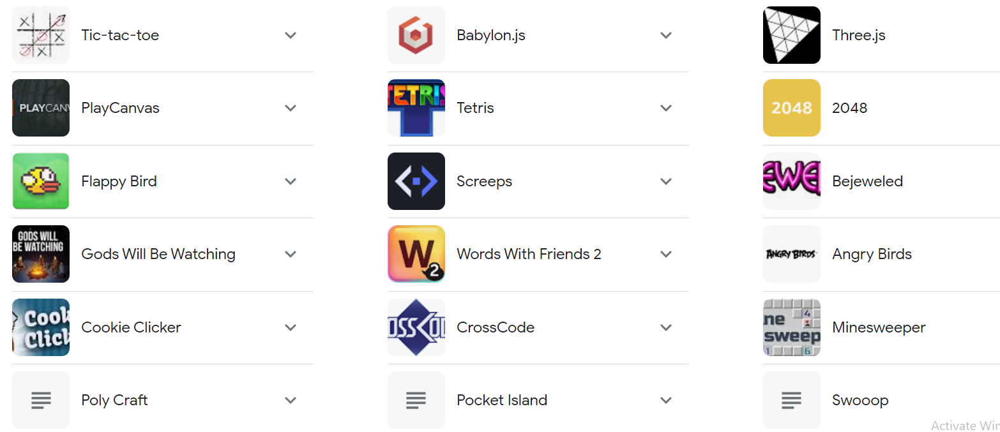

<details>
<summary>JS хөгжүүлэгчийн цалин</summary>

<br>

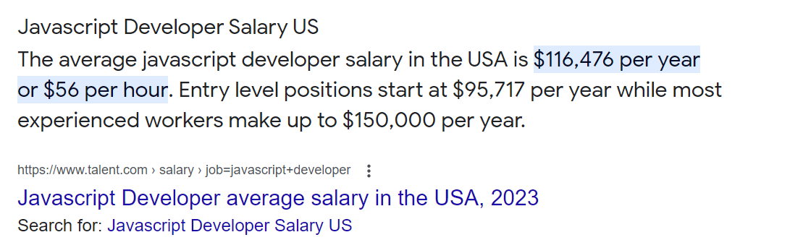

</details>

</details>

---

<details>
<summary><b>2. Анхны код — Hello world</b></summary>

<br>

1. `js-8` нэртэй хавтас үүсгээд VSCode-д нээ (**Open Folder**).
2. Багшаас авсан `index.html`, `main.js`-ээ хуул.

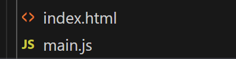

3. `index.html` дотор JS файлаа холбосон мөр байна:

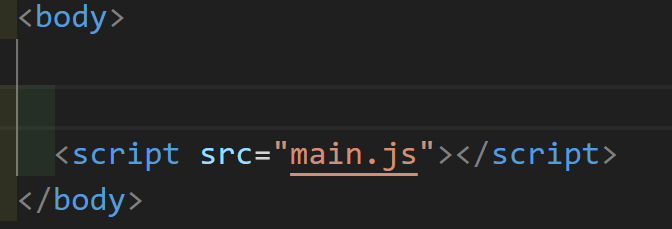

4. `main.js`-д:

```js
console.log("HELLO WORLD");
```

5. `index.html`-ийг браузерт нээ → **F12** → **Console**.

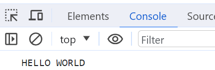

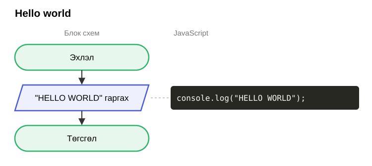

Код засах бүрт: **Ctrl+S** → браузерт **F5**.

<details>
<summary>Console-д улаан алдаа гарвал</summary>

<br>

| Алдаа | Шалтгаан |
| ----- | -------- |
| `SyntaxError` | Хашилт `" "` эсвэл хаалт `( )` дутуу |
| `... is not defined` | Хувьсагчийн нэрийг буруу бичсэн (`Ner` ≠ `ner`) |
| Юу ч гарахгүй | Ctrl+S хийгээгүй, эсвэл F5 дараагүй |

Алдааны баруун талд `main.js:5` гэж байвал 5-р мөрөө хар.

</details>

</details>

---

<details>
<summary><b>3. Блок схем — кодын зураг</b></summary>

<br>

Компьютер кодыг **дээрээс доош, мөр мөрөөр** уншина. Блок схем = энэ дарааллын зураг.

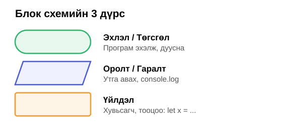

**Нэг дүрс = нэг (эсвэл хэдэн) мөр код.** Хэцүү бодлогыг эхлээд цаасан дээр зур, дараа нь код болго.

</details>

---

<details>
<summary><b>4. Хувьсагч — математикийн x шиг</b></summary>

<br>

Математикт `x = 5` бол `x + 3 = 8`. JS-д яг адилхан — `x` бол **утгын нэр**.

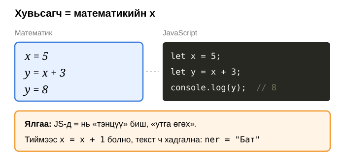

```js
let ner = "Бат";      // текст — хашилтанд
let nas = 12;         // тоо — хашилтгүй
let suragch = true;   // үнэн / худал

nas = 13;             // утгыг солив
const pi = 3.14;      // const — утга нь өөрчлөгдөхгүй
```

| Код | Утга |
| --- | ---- |
| `let x = 5` | `x` гэдэг нэр үүсгэж, 5 гэсэн утга өгнө |
| `x = 7` | `x`-ийн утгыг 7 болгоно (`let` дахин бичихгүй) |
| `const` | Утгыг нь солих боломжгүй |

<details>
<summary>Хувьсагчийн нэр</summary>

<br>

Латин үсэг, хоосон зайгүй: `ner`, `shineNas`. `shine nas`, `нэр` гэж бичиж **болохгүй**. Том, жижиг үсэг өөр: `Ner` ≠ `ner`.

</details>

</details>

---

<details>
<summary><b>5. Тооцоо ба текст нийлүүлэх</b></summary>

<br>

| Код | Хариу |
| --- | ----- |
| `7 + 3` | 10 |
| `7 - 3` | 4 |
| `7 * 3` | 21 |
| `7 / 2` | 3.5 |
| `2 + 3 * 4` | 14 — үржих эхэлнэ |
| `(2 + 3) * 4` | 20 — хаалт эхэлнэ |

**Текст нийлүүлэх:** `+` нь текстийг **наана**. Хоосон зайг `" "` гэж нэм.

```js
let ner = "Сараа";
let hot = "Дархан";
let nas = 11;

console.log("Сайн уу, " + ner);                    // Сайн уу, Сараа
console.log(ner + " " + hot + " хотод амьдардаг"); // Сараа Дархан хотод амьдардаг
console.log(ner + " " + nas + " настай");          // Сараа 11 настай
console.log("Ирэх жил " + (nas + 1) + " настай");  // Ирэх жил 12 настай
```

<details>
<summary><code>(nas + 1)</code> — хаалтгүй бол?</summary>

<br>

`"Ирэх жил " + nas + 1` → `Ирэх жил 111`. Текст эхэлсэн тул `1`-ийг ч наачихна. Хаалт = эхлээд тоогоо бод.

</details>

**Утга нэмэгдэх нь:** `x = x + 1` — баруун талыг бодоод, хариуг `x`-д өгнө.

| Мөр | `x`-ийн утга |
| --- | ------------ |
| `let x = 5;` | 5 |
| `x = x + 1;` | 6 |
| `x = x * 2;` | 12 |

</details>

---

## Дасгал

| Түвшин | Дасгал |
| ------ | ------ |
| Анхан | 1–2 |
| Дунд | 3–5 |

Бүх дасгалыг `main.js`-д, `// Дасгал N` мөрийн доор бич. Нэг нэрийг `let`-ээр **хоёр удаа** зарлавал алдаа гарна — өөр нэр өг (`nas2`).

---

<details>
<summary><b>Дасгал 1 — Танилцуулга</b> · Анхан · хамт</summary>

<br>

`ner`, `nas` хувьсагчид өөрийн нэр, насаа хийж, өгүүлбэр гарга.

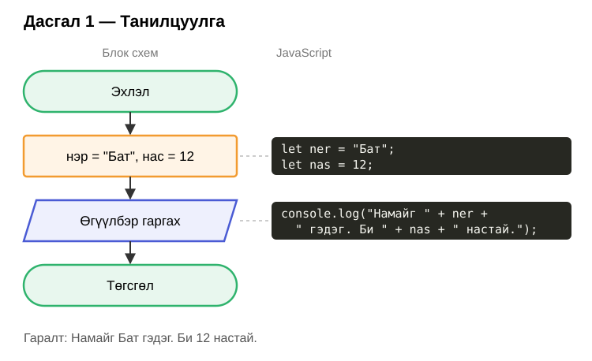

Хашилт доторх **хоосон зайг** мартвал `НамайгБатгэдэг` болно.

</details>

---

<details>
<summary><b>Дасгал 2 — Таамагла</b> · Анхан</summary>

<br>

Эхлээд **цаасан дээр** таамаглаж бич, дараа нь ажиллуулж шалга.

```js
console.log(5 + 5);
console.log("5" + 5);
console.log(90 + "77");
console.log("codely" + "academy");
console.log(1655 / 5);
console.log(2 + 3 * 4);
console.log((2 + 3) * 4);
console.log("Бат" + 12);
```

<details>
<summary>Хариу</summary>

<br>

| Код | Хариу | Яагаад |
| --- | ----- | ------ |
| `5 + 5` | 10 | Тоо + тоо |
| `"5" + 5` | 55 | Хашилттай бол текст → наалдана |
| `90 + "77"` | 9077 | Нэг нь текст бол наалдана |
| `"codely" + "academy"` | codelyacademy | Текст + текст |
| `1655 / 5` | 331 | |
| `2 + 3 * 4` | 14 | Үржих эхэлнэ |
| `(2 + 3) * 4` | 20 | Хаалт эхэлнэ |
| `"Бат" + 12` | Бат12 | Текст + тоо → наалдана |

</details>

</details>

---

<details>
<summary><b>Дасгал 3 — Ирээдүйн нас</b> · Дунд</summary>

<br>

Төрсөн он, ирээдүйн он → тэр онд хэдэн настай вэ? Блок схемийн `?`, кодын `...`-г бөглө.

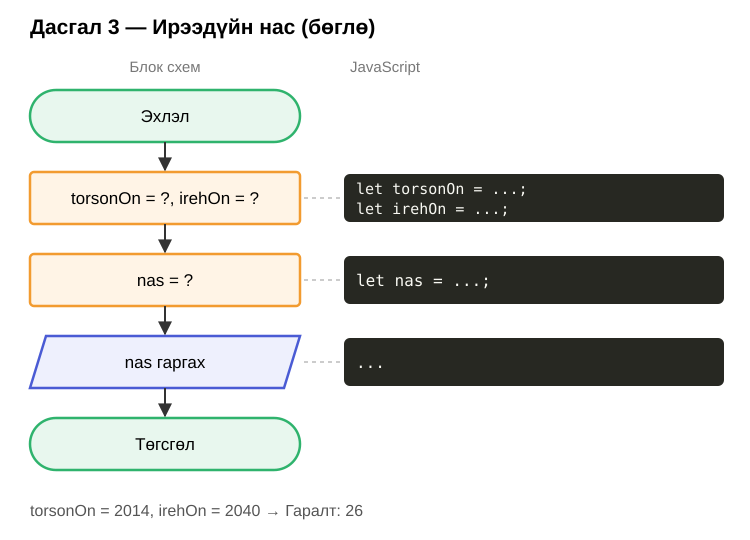

Өөрийн төрсөн оноор: 2050 онд хэдэн настай болох вэ?

</details>

---

<details>
<summary><b>Дасгал 4 — Утга солих</b> · Дунд</summary>

<br>

`a = "cola"`, `b = "water"` → `a`-г `"water"`, `b`-г `"cola"` болго. Утгыг гараар бичихгүй.

<details>
<summary>Зөвлөгөө — блок схем</summary>

<br>

Хоёр аяганы ундааг солихын тулд **гурав дахь хоосон аяга** хэрэгтэй.

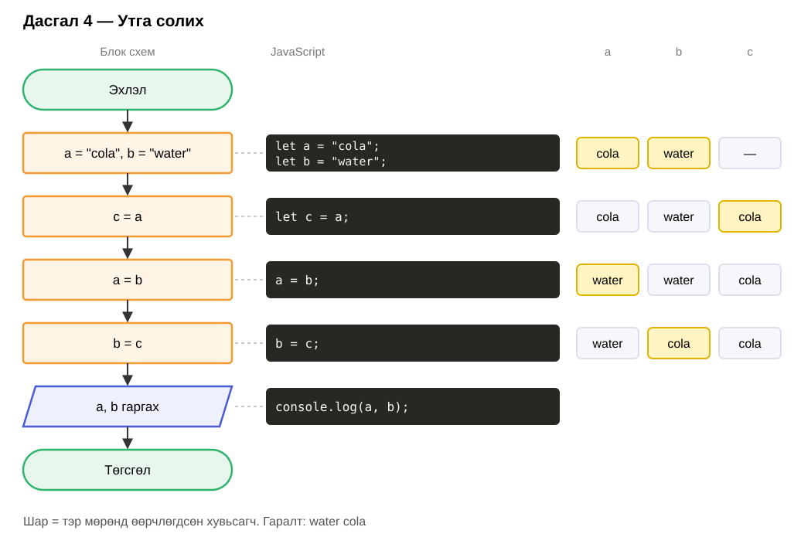

`a = b; b = a;` гэвэл яах вэ? Хоёулаа `water` болно — `cola` алга болсон.

</details>

**Нэмэлт:** `x = 2, y = 6, z = 3` → `x = 6, y = 3, z = 2` болго. Блок схемээ өөрөө зур.

</details>

---

<details>
<summary><b>Дасгал 5 — A = B * C - D</b> · Дунд</summary>

<br>

```js
let B = 6;
let C = 3;
let D = 2;
let A = B * C - D;
console.log(A);   // 16
```

Зөвхөн `B`, `C`, `D`-ийн утгыг өөрчилж, 4-р мөрийг **өөрчлөхгүйгээр**:

| Зорилго | ✔️ |
| ------- | -- |
| A = 0 | ⬜ |
| A = 100 | ⬜ |
| A = 1 | ⬜ |

</details>

---

<details>
<summary><b>Code Battle</b></summary>

<br>

- Раунд бүрт бүгд `main.js`-д бодно. Console-д зөв хариу гарсан бол гараа өргө.
- Хамгийн түрүүнд гаргасан 3 хүн: **3 · 2 · 1** оноо.
- Раунд 1, 2, 6 доор байна. 3–5-ыг багш самбарт бичнэ.

**Раунд 1 — Нийт цаг.** Хоног, цаг өгөгдсөн → нийт хэдэн цаг вэ?

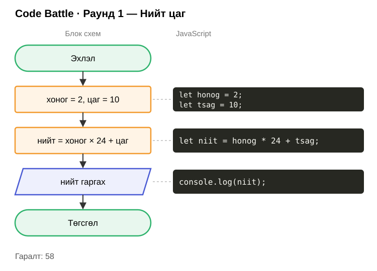

**Раунд 2 — Амьдарсан хугацаа.** Насаа оруул → ойролцоогоор хэдэн өдөр, цаг, минут амьдарсан бэ? (1 жил = 365 өдөр)

```text
12 нас = 4380 өдөр = 105120 цаг = 6307200 минут
```

Блок схем байхгүй — эхлээд цаасан дээр зур: хэдэн хувьсагч хэрэгтэй вэ?

**Раунд 3–5** — багш самбарт бичнэ.

**Раунд 6 — Тонгорогсон тоо** · хамгийн хэцүү. 4 оронтой тоо → эсрэгээр нь: `1234` → `4321`.

| Код | Хариу | Утга |
| --- | ----- | ---- |
| `1234 % 10` | 4 | 10-д хуваахад үлдэх үлдэгдэл |
| `Math.floor(1234 / 10)` | 123 | Бутархайг хаяна |

<details>
<summary>Зөвлөгөө — блок схем</summary>

<br>

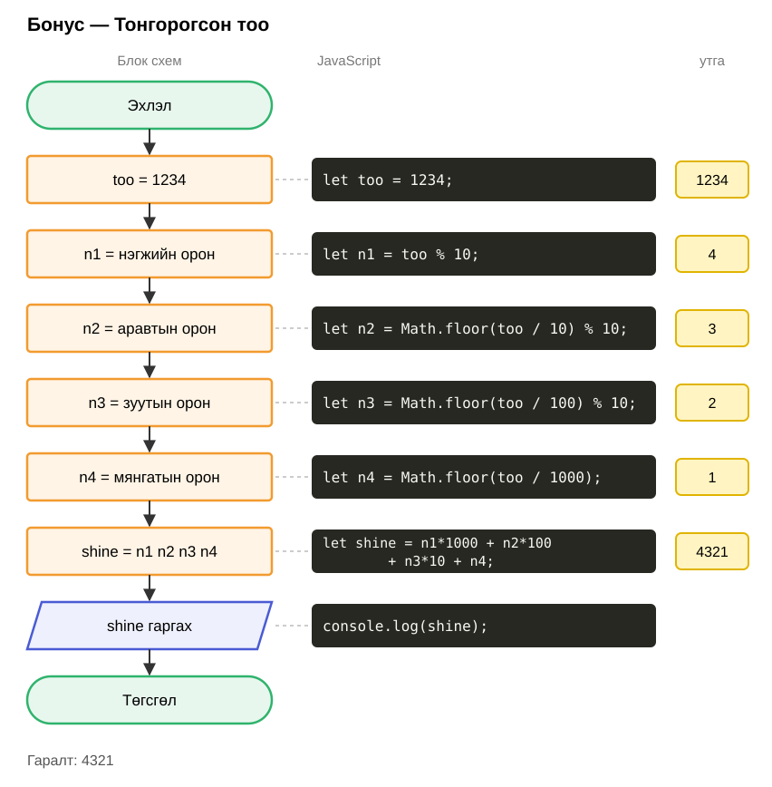

</details>

</details>

---

<details>
<summary><b>Гэрийн даалгавар</b></summary>

<br>

| #   | Юу хийх | ✔️  |
| --- | ------- | --- |
| 1   | Дасгал 1–5 дуусга | ⬜  |
| 2   | Battle-ийн Раунд 2 (Амьдарсан хугацаа)-ын блок схемийг цаасан дээр зурж, зургийг нь Discord-д тавь | ⬜  |
| 3   | Раунд 6 — Тонгорогсон тоо (заавал биш) | ⬜  |
| 4   | Copilot-оор нэг дасгалаа вэб хуудас болгож, screenshot-оо Discord-д тавь | ⬜  |

Дараагийн хичээлд: код **шийдвэр гаргадаг** болно — `if / else`.

</details>

---

<details>
<summary><b>VSCode Copilot — JS кодоо UI-тай болгох</b></summary>

<br>

Бид тооцоогоо JS-ээр бичсэн. Одоо **AI-аар** input, товч, өнгө нэмүүлж жинхэнэ вэб хуудас болгоно.

| # | Алхам |
| - | ----- |
| 1 | VSCode → **Extensions** (`Ctrl+Shift+X`) → `GitHub Copilot` хайж суулга |
| 2 | **Sign in** гэж гарвал GitHub акаунтаараа нэвтэр (Copilot Free) |
| 3 | `js-8` хавтсаа нээлттэй байлгаад **Chat** нээ: `Ctrl+Alt+I` |
| 4 | Chat-ын доор горимыг **Agent** болго |
| 5 | Доорх prompt-ийг бич → Enter |
| 6 | Copilot файл үүсгэнэ → **Keep** дар → `app.html`-ийг браузерт нээ |

**Prompt жишээ:**

```text
main.js доторх "Дасгал 3 — Ирээдүйн нас"-ыг вэб хуудас болго.
Шинэ app.html, app.js файл үүсгэ. main.js-ийг бүү өөрчил.
Төрсөн он, ирэх он оруулах 2 input, "Бодох" товч байна.
Хариуг том үсгээр харуул. Тод өнгөтэй, голлуулсан карт.
Тооцоо нь: nas = irehOn - torsonOn
```

<details>
<summary>Цааш сайжруулах</summary>

<br>

| Хүсэлт | Prompt |
| ------ | ------ |
| Өнгө солих | `Дэвсгэрийг хар, товчийг ногоон болго` |
| Өөр дасгал | `Дасгал 1-ийг ч гэсэн app.html-д нэм: нэр, нас оруулаад өгүүлбэр гарна` |
| Алдаа гарвал | F12 → Console-ийн улаан алдааг хуулж Chat-д тавиад `Энэ алдааг засаад өг` |
| Буцаах | Таалагдаагүй бол **Undo** |

Copilot `document`, `querySelector` гэх мэт код бичнэ — одоохондоо ойлгох шаардлагагүй. Гол нь **тооцоо = чиний бичсэн JS**.

</details>

</details>
