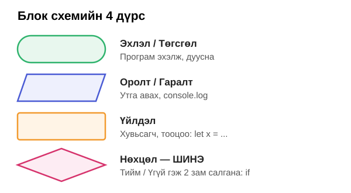
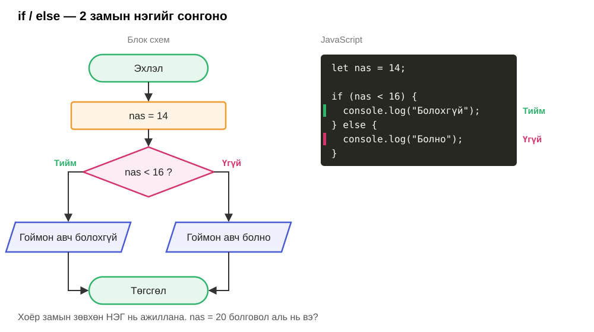
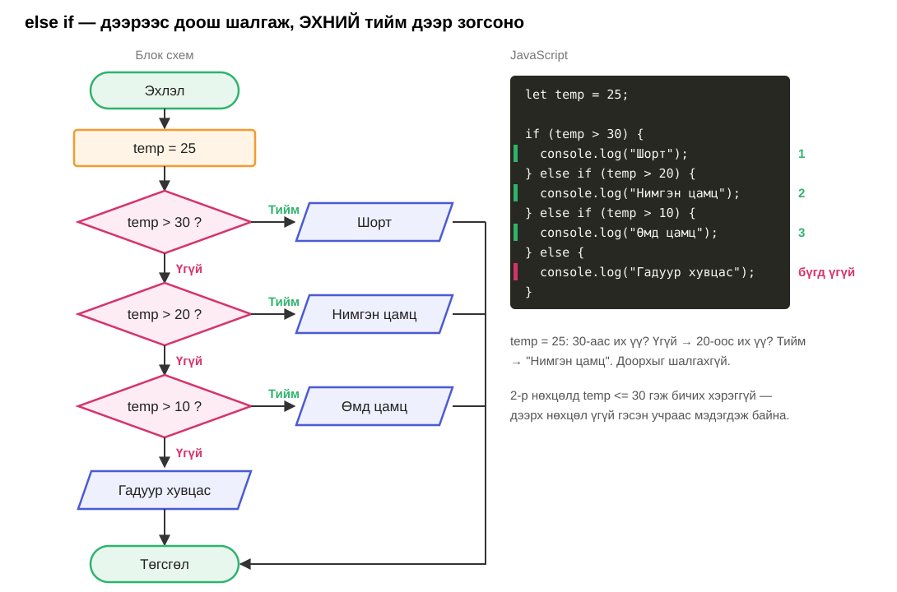
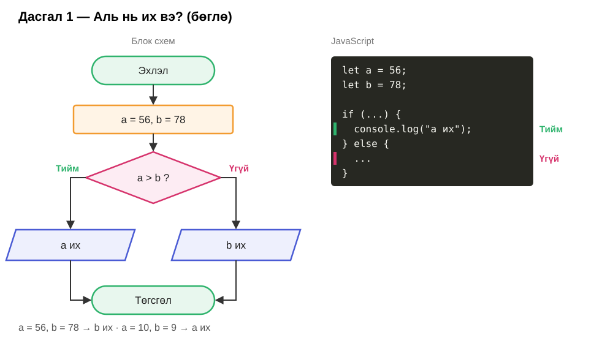

# Хичээл 9 — Нөхцөл: if / else

### Өнөөдөр код **шийдвэр гаргадаг** болно: "Хэрэв ... бол ингэ, үгүй бол тэг".

> Алхам бүр дээр **дарж нээнэ**.

---

<details>
<summary><b>0. Бэлтгэл</b></summary>

<br>

1. `js-9` хавтас үүсгээд VSCode-д нээ (**Open Folder**).
2. [index.html](index.html), [main.js](main.js)-ийг татаж аваад (**Download raw file**) хавтсандаа хий.
3. `index.html`-ийг браузерт нээ → **F12** → **Console**.

Хичээл 8-тай яг адилхан. Код засах бүрт: **Ctrl+S** → **F5**.

</details>

---

<details>
<summary><b>1. Жиших үйлдэл — хариу нь true эсвэл false</b></summary>

<br>

`let x = 3;` үед:

| Код | Утга | Хариу |
| --- | ---- | ----- |
| `x > 3` | их | false |
| `x >= 3` | их буюу тэнцүү | true |
| `x < 3` | бага | false |
| `x <= 3` | бага буюу тэнцүү | true |
| `x === 3` | тэнцүү | true |
| `x !== 3` | тэнцүү биш | false |

```js
console.log(10 > 7);     // true
console.log(5 === 6);    // false
```

<details>
<summary><code>=</code> ба <code>===</code> өөр</summary>

<br>

| Код | Утга |
| --- | ---- |
| `x = 3` | Хайрцагт 3 **хийнэ** |
| `x === 3` | Хайрцагт 3 байна **уу?** гэж асууна |

`"5" === 5` → **false**. Хашилттай `"5"` нь текст, `5` нь тоо — өөр төрөл.

</details>

</details>

---

<details>
<summary><b>2. Блок схемийн шинэ дүрс — ромбо</b></summary>

<br>



Ромбо = **нөхцөл** шалгах. Хариу нь Тийм (true) эсвэл Үгүй (false) — замаас **нэг** нь сонгогдоно.

</details>

---

<details>
<summary><b>3. if / else</b></summary>

<br>



| Хэсэг | Утга |
| ----- | ---- |
| `if ( ... )` | Хаалтан дотор асуулт |
| `{ ... }` | Тийм бол энд байгаа код ажиллана |
| `else { ... }` | Үгүй бол энд. Хэрэггүй бол бичихгүй байж болно |

</details>

---

<details>
<summary><b>4. else if — олон зам, дараалал чухал</b></summary>

<br>



Компьютер **дээрээс доош** шалгаж, **эхний** Тийм дээр зогсоно. Бусдыг огт харахгүй.

<details>
<summary>Дарааллыг сольвол юу болох вэ?</summary>

<br>

```js
let temp = 35;
if (temp > 10) {
  console.log("Өмд цамц");     // 35 > 10 → Тийм → энд зогсоно
} else if (temp > 30) {
  console.log("Шорт");         // хэзээ ч хүрэхгүй
}
```

Хамгийн **хатуу** нөхцөлийг эхэнд тавь.

</details>

</details>

---

<details>
<summary><b>5. && (бас) ба || (эсвэл)</b></summary>

<br>

| Код | Хэзээ true вэ? | Жишээ |
| --- | -------------- | ----- |
| `A && B` | **Хоёулаа** true | Кино: 12+ настай **бас** тасалбартай |
| `A \|\| B` | **Аль нэг нь** true | Амралт: бямба **эсвэл** ням |

```js
let nas = 13;
let tasalbar = true;

if (nas >= 12 && tasalbar === true) {
  console.log("Орж болно");
} else {
  console.log("Орж болохгүй");
}
```

<details>
<summary>Бүх хувилбар</summary>

<br>

| A | B | `A && B` | `A \|\| B` |
| - | - | -------- | ---------- |
| true | true | true | true |
| true | false | false | true |
| false | true | false | true |
| false | false | false | false |

</details>

</details>

---

## Дасгал

| Түвшин | Дасгал |
| ------ | ------ |
| Анхан | 1–3 |
| Дунд | 4–6 |
| Ахисан | 7–8, Бонус |

Бүх дасгалыг `main.js`-д, `// Дасгал N` мөрийн доор бич. Утгыг нь өөрчилж **бүх замаар** шалга.

---

<details>
<summary><b>Дасгал 1 — Аль нь их вэ?</b> · Анхан · хамт</summary>

<br>



**Нэмэлт:** `a = 7, b = 7` үед юу гарч байна? `else if` нэмээд `"Тэнцүү"` гэж гаргана уу.

</details>

---

<details>
<summary><b>Дасгал 2 — Таамагла</b> · Анхан</summary>

<br>

Эхлээд **цээжээр** true / false гэж бод, дараа нь ажиллуулж шалга.

```js
console.log(8 > 8);
console.log(8 >= 8);
console.log(3 !== 4);
console.log("5" === 5);
console.log(10 % 2 === 0);
console.log(5 > 3 && 2 > 4);
console.log(5 > 3 || 2 > 4);
```

<details>
<summary>Хариу</summary>

<br>

| Код | Хариу | Яагаад |
| --- | ----- | ------ |
| `8 > 8` | false | Тэнцүү, их биш |
| `8 >= 8` | true | Тэнцүү байж болно |
| `3 !== 4` | true | Тэнцүү биш нь үнэн |
| `"5" === 5` | false | Текст ≠ тоо |
| `10 % 2 === 0` | true | Үлдэгдэл 0 |
| `5 > 3 && 2 > 4` | false | Хоёр дахь нь false |
| `5 > 3 \|\| 2 > 4` | true | Эхнийх нь true |

</details>

</details>

---

<details>
<summary><b>Дасгал 3 — Тэгш үү, сондгой юу?</b> · Анхан</summary>

<br>

`x = 57349` → `сондгой`. `x = 12` → `тэгш`.

`%` — хуваахад үлдэх үлдэгдэл. Тэгш тоог 2-т хуваахад үлдэгдэл **0**.

| Код | Хариу |
| --- | ----- |
| `12 % 2` | 0 |
| `7 % 2` | 1 |

Ямар нөхцөл шалгах вэ?

</details>

---

<details>
<summary><b>Дасгал 4 — Нууц үг</b> · Дунд</summary>

<br>

`password`, `password2` хоёр хувьсагч.

| Нөхцөл | Гаралт |
| ------ | ------ |
| Ижил | Нууц үг амжилттай солигдлоо |
| Өөр | Нууц үгээ зөв давтаж оруулаарай |

`"abc123"` ба `"abc124"`, `"Abc123"` ба `"abc123"` гэж шалга — том, жижиг үсэг өөр гэдгийг харна.

</details>

---

<details>
<summary><b>Дасгал 5 — Дүн</b> · Дунд</summary>

<br>

`onoo` (0–100) → дүн.

| Оноо | Дүн |
| ---- | --- |
| 90–100 | A |
| 80–89 | B |
| 70–79 | C |
| 60–69 | D |
| 0–59 | F |

`onoo = 78` → `C`. `else if`-ийг **хамгийн өндрөөс** эхлүүл.

</details>

---

<details>
<summary><b>Дасгал 6 — Алдааг ол</b> · Дунд</summary>

<br>

Энэ код 95 оноонд `D` гэж гаргаж байна. Яагаад? Зас.

```js
let onoo2 = 95;

if (onoo2 >= 60) {
  console.log("D");
} else if (onoo2 >= 70) {
  console.log("C");
} else if (onoo2 >= 90) {
  console.log("A");
}
```

<details>
<summary>Зөвлөгөө</summary>

<br>

95 >= 60 уу? Тийм → эхний `{ }` ажиллаад **зогсоно**. Бусад нь шалгагдахгүй. (4-р алхам)

</details>

</details>

---

<details>
<summary><b>Дасгал 7 — FizzBuzz</b> · Ахисан</summary>

<br>

| Нөхцөл | Гаралт |
| ------ | ------ |
| 3-д ч, 5-д ч хуваагдана | FizzBuzz |
| Зөвхөн 3-д | Fizz |
| Зөвхөн 5-д | Buzz |
| Алинд нь ч үгүй | тоо өөрөө |

`9 → Fizz` · `25 → Buzz` · `15 → FizzBuzz` · `79 → 79`

Аль нөхцөлийг **эхэнд** тавих вэ? 15-аар шалгаж үз.

</details>

---

<details>
<summary><b>Дасгал 8 — Замын цагдаа</b> · Ахисан</summary>

<br>

- Дээд хурд **80** км/ц.
- 80-аас **5 км/ц хэтрэх бүрт 1 оноо** хасна.
- **5 буюу түүнээс их** оноо алдвал эрх хасна.

| Оролт | Гаралт |
| ----- | ------ |
| `speed = 70` | Хурд хэвийн |
| `speed = 100` | 4 оноо алдсан. Эрх хасагдаагүй |
| `speed = 120` | 8 оноо алдсан. Эрх хасагдсан |

Хэдэн нөхцөл шалгах вэ?

<details>
<summary>Зөвлөгөө</summary>

<br>

Хасах оноо: `Math.floor((speed - 80) / 5)` — Хичээл 8-ын бонусын `Math.floor`.

</details>

</details>

---

<details>
<summary><b>Бонус — Өндөр жил</b> · Ахисан</summary>

<br>

Өндөр жил (2-р сар 29 хоногтой):

- 4-т хуваагдана, **бас** 100-д хуваагдахгүй,
- **эсвэл** 400-д хуваагдана.

`2024 → өндөр жил` · `2023 → энгийн` · `1900 → энгийн` · `2000 → өндөр жил`

`&&`, `||`-ийг **нэг** `if` дотор хамт хэрэглэ. Хаалт `( )` хэрэгтэй.

</details>

---

<details>
<summary><b>Нэмэлт — prompt / alert</b> · Ахисан</summary>

<br>

Утгыг кодонд биш, **гараас** оруулж болно.

```js
let nas = Number(prompt("Хэдэн настай вэ?"));

if (nas >= 12) {
  alert("Орж болно");
} else {
  alert("Орж болохгүй");
}
```

| Код | Утга |
| --- | ---- |
| `prompt("...")` | Цонх гаргаж, бичсэнийг **текст**ээр авна |
| `Number(...)` | Текстийг **тоо** болгоно |
| `alert("...")` | Цонхонд харуулна |

**Даалгавар:** Дасгал 3 эсвэл 5-аа `prompt` / `alert`-тэй болго.

<details>
<summary><code>Number</code>-гүй бол?</summary>

<br>

`prompt` үргэлж текст буцаана: `"13"`. `"13" === 13` → **false** (1-р алхам).

</details>

</details>

---

<details>
<summary><b>Debug Battle</b></summary>

<br>

- Багш дэлгэцэнд **алдаатай** код үзүүлнэ → бүгд `main.js`-д хуулж засна.
- Зөв ажиллуулаад гараа өргө — **юу буруу байсныг** хэлж чадвал оноо.
- Хамгийн түрүүнд засварласан 3 хүн: **3 · 2 · 1** оноо. 3 раунд.

</details>

---

<details>
<summary><b>Гэрийн даалгавар</b></summary>

<br>

| #   | Юу хийх | ✔️  |
| --- | ------- | --- |
| 1   | Дасгал 1–6 дуусга | ⬜  |
| 2   | Дасгал 8-ын блок схемийг цаасан дээр зурж, зургийг нь Discord-д тавь | ⬜  |
| 3   | Дасгал 7, Бонус (заавал биш) | ⬜  |

Дараагийн хичээлд: кодыг **давтан** ажиллуулна — `for`, `while`.

</details>
