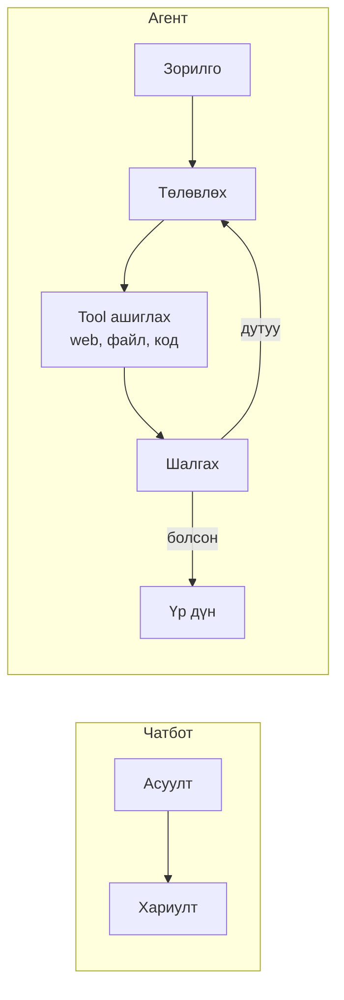

# Хичээл 1 — Agentic AI: чатбот биш, ажилтан

> **Агуулга:** _(хичээл орсны дараа бөглөнө)_

120 мин · Хүүхэд + Adult хамт · Дараах: [Хичээл 2](../Хичээл%202%20-%20AI%20стилист) (Ням — энэ циклийг дуусгана)

| # | Хэсэг | Хугацаа |
| - | ----- | ------- |
| 1 | Wow: AI-ийн бүтээлүүд, харьцуулалт | 20 мин |
| 2 | Чатбот vs Агент | 15 мин |
| 3 | Agentic tool-ууд = нэг санаа | 10 мин |
| 4 | Codex setup | 15 мин |
| 5 | Дасгал 1: Black Friday deal хайх | 30 мин |
| 6 | Skill болгох → өөр бараа хайх | 25 мин |
| 7 | Дүгнэлт, ГД | 5 мин |

> Хэсэг бүр дээр **дарж нээнэ**.

---

<details>
<summary><b>1. Wow: AI-ийн бүтээлүүд, харьцуулалт</b> · 20 мин</summary>

<br>

Багш бүтээлүүдийг **загварын нэргүйгээр** үзүүлнэ → анги "аль AI хийсэн бэ?" гэж таана → дараа нь нэрийг нээнэ.

| # | Бүтээл | Загвар | Линк |
| - | ------ | ------ | ---- |
| 1 | _(Instagram пост)_ | Claude Fable | [Instagram](https://www.instagram.com/p/DfosPNZkqC0/?img_index=4) |
| 2 | _(бөглөнө)_ | GPT Astra / Sol | _(линк)_ |
| 3 | _(бөглөнө)_ | Gemini (хамгийн сүүлийн загвар) | _(линк)_ |

**Харьцуулалт** — самбар дээр ангиараа оноо өгнө (1–5):

| Шалгуур | Fable | GPT | Gemini |
| ------- | :---: | :---: | :---: |
| Гоё харагдах | | | |
| Prompt-ыг зөв дагасан | | | |
| Хурд | | | |
| Үнэ (free tier) | | | |

<details>
<summary>Багшид</summary>

- Ялагч гэж байхгүй — **даалгавраас** хамаарч өөр загвар сайн байдаг гэдгийг хэл.
- Нэг prompt-ыг 3 загварт өгсөн бүтээл байвал хамгийн тод харьцуулалт болно.

</details>

</details>

<details>
<summary><b>2. Чатбот vs Агент</b> · 15 мин</summary>

<br>



| | Чатбот | Агент |
| - | ------ | ----- |
| Юу өгөх | Асуулт | **Зорилго** |
| Юу хийх | Текст бичнэ | Хайна, файл үүсгэнэ, код ажиллуулна |
| Алхам | 1 | Олон, өөрөө шийднэ |
| Жишээ | "iPhone хэд вэ?" | "5 дэлгүүрээс iPhone-ийн хямдралыг хайж хүснэгт гарга" |

</details>

<details>
<summary><b>3. Agentic tool-ууд = нэг санаа</b> · 10 мин</summary>

<br>

Бүгд ижил зарчмаар ажилладаг. Нэгийг сурвал бусдыг нь шууд ашиглана. Бид **Codex** ашиглана — free tier сайн.

| Tool | Компани | Тэмдэглэл |
| ---- | ------- | --------- |
| **Codex** | OpenAI | ChatGPT account-аар, **бид үүнийг ашиглана** |
| Claude desktop (Cowork / Code) | Anthropic | 18+ |
| Antigravity | Google | Agentic IDE |
| ChatGPT desktop | OpenAI | Чат + agent mode |

Нийтлэг ойлголт: **prompt → төлөвлөгөө → зөвшөөрөл → үйлдэл → skill**.

</details>

<details>
<summary><b>4. Codex setup</b> · 15 мин</summary>

<br>

1. [chatgpt.com/codex](https://chatgpt.com/codex) руу орж ChatGPT account-аараа нэвтэр (хүүхэд — эцэг эхийн зөвшөөрөлтэй).
2. Codex app-ыг суулгаж, `ai-lab` нэртэй шинэ хавтас нээ.
3. Тест: `Сайн уу! Чи юу хийж чадах вэ? 3 мөрөөр хариул.`

<details>
<summary>Багшид — хичээлээс өмнө шалга</summary>

- Codex app суулгах алхам, free tier-ийн хязгаар одоо ямар байгааг.
- Web search Codex-д асаалттай эсэх (Дасгал 1-д хэрэгтэй).
- Account үүсгэж чадаагүй сурагч хөрштэйгөө хос болж ажиллана.

</details>

</details>

<details>
<summary><b>5. Дасгал 1: Black Friday deal хайх</b> · 30 мин</summary>

<br>

**Зорилго:** AI агент интернэтээс хямдрал хайж, **эх сурвалжтай** хүснэгт гаргана.

1. Нэг бараа сонго (жишээ нь AirPods, пүүз, гоо сайхан).
2. Prompt өг:

```text
Монголд Black Friday хямдралтай [БАРАА]-г хай.
Эх сурвалж: онлайн дэлгүүрийн вэб сайт, Facebook page, Instagram.
Хүснэгт гарга: бараа | хуучин үнэ | хямд үнэ | хямдрал % | дэлгүүр | линк | огноо.
Дүрэм:
- Линкгүй мэдээллийг бүү оруул.
- Үнийг зохиож болохгүй — олдохгүй бол "тодорхойгүй".
- Хамгийн хямдыг дээр нь тавь.
Эхлээд хаанаас хайхаа жагсаагаад надаас зөвшөөрөл ав.
```

3. Төлөвлөгөөг нь уншаад зөвшөөр.
4. **Шалга:** 2 линкийг өөрөө нээж үнэ таарч байгаа эсэхийг хар.

<details>
<summary>Яагаад FB / Insta-с цөөн олддог вэ?</summary>

Facebook, Instagram-ийн ихэнх пост нэвтрэлт (login) шаарддаг тул агент уншиж чаддаггүй. Вэб сайтаас илүү олон үр дүн гарна. Ингээд AI-ийн **хязгаарыг** харна.

</details>

</details>

<details>
<summary><b>6. Skill болгох → өөр бараа хайх</b> · 25 мин</summary>

<br>

**Skill** = нэг удаа заагаад, олон удаа ашиглах заавар. Дасгал 1-ийн prompt-оо дахин бичихгүй.

1. Codex-д:

```text
Бидний сая хийсэн хайлтыг "deal-finder" нэртэй skill болго.
Оролт: барааны нэр, дээд үнэ (заавал биш).
Миний дүрмүүдийг (линктэй, үнэ зохиохгүй, хүснэгт, хямдаас эрэмбэлэх) хадгал.
```

2. Skill-ийн файлыг нээж уншаарай. Ойлгомжгүй мөр байвал засуул.
3. **Өөр бараагаар турш:** `deal-finder: Nintendo Switch, 1,000,000₮-өөс доош`.
4. Үр дүнг хөрштэйгөө харьцуул — skill ижил форматаар гаргасан уу?

Жишээ skill: [skills/deal-finder/SKILL.md](skills/deal-finder/SKILL.md)

**Adult бонус:** skill-д "миний дуртай дэлгүүрүүд" жагсаалт нэмж, тэдгээрээс эхэлж хайдаг болго.

</details>

<details>
<summary><b>7. Дүгнэлт, ГД</b> · 5 мин</summary>

<br>

- Агент = зорилго → төлөвлөх → tool → шалгах.
- Skill = дахин ашиглах заавар.
- AI алдаа гаргана — **линкээр шалга**.

**ГД:** Гэрийнхэндээ хэрэгтэй 1 барааг `deal-finder`-ээр хайж, хүснэгтийг нь авчир.

</details>
