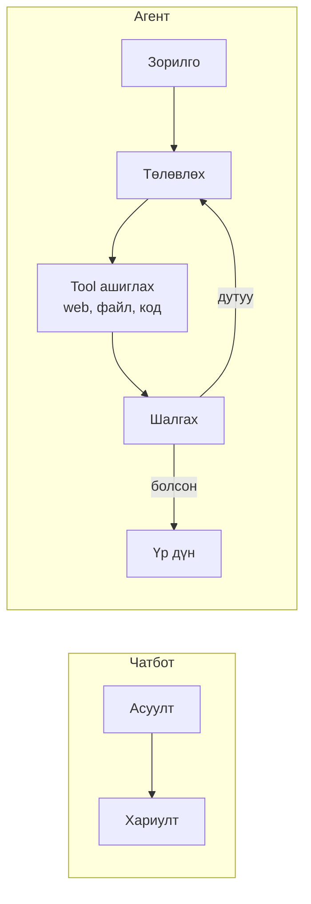

# Хичээл 1 — Agentic AI: чатбот биш, ажилтан

> **Агуулга:** _(хичээл орсны дараа бөглөнө)_

120 мин · Хүүхэд + Adult хамт · Дараах: [Хичээл 2](../Хичээл%202%20-%20AI%20стилист) (Ням — Claude-ийн боломжууд, prompt-оо skill болгоно)

| # | Хэсэг | Хугацаа |
| - | ----- | ------- |
| 1 | AI-ийн бүтээлүүд, харьцуулалт | 15 мин |
| 2 | Чатбот vs Агент | 10 мин |
| 3 | Agentic tool-ууд = нэг санаа | 5 мин |
| 4 | Codex setup | 15 мин |
| 5 | Дасгал 1: Black Friday deal хайх | 25 мин |
| 6 | Дасгал 1 → `deal-finder` skill | 15 мин |
| 7 | Дасгал 2: Үс засалт 3x3 | 30 мин |
| 8 | Дүгнэлт, ГД | 5 мин |

> Хэсэг бүр дээр **дарж нээнэ**.

<details>
<summary><b>Аюулгүй байдал</b></summary>

<br>

- Зөвхөн **өөрийн** эсвэл **зөвшөөрөл авсан** хүний зураг.
- Нүүрний зураг AI-д оруулах заалт эцэг эхийн зөвшөөрлийн хуудсанд байна.
- Гарсан зургийг нийтэд постлохоос өмнө тухайн хүнээс асуу.

</details>

---

<details>
<summary><b>1. AI-ийн бүтээлүүд, харьцуулалт</b> · 15 мин</summary>

<br>

Багш бүтээлүүдийг **загварын нэргүйгээр** үзүүлнэ → анги "аль AI хийсэн бэ?" гэж таана → дараа нь нэрийг нээнэ.

| # | Загвар | Бүтээл |
| - | ------ | ------ |
| 1 | Claude Opus 5.6 | [Instagram](https://www.instagram.com/p/DgPGamfkgOQ/?img_index=3) |
| 2 | Claude Fable 5.2 | [Instagram](https://www.instagram.com/p/DfmVFX0kg7T/?img_index=5) · [2](https://www.instagram.com/p/DfosPNZkqC0/?img_index=4) |
| 3 | GPT Astra / Sol, Opus | [N1njaCodex profile](https://www.instagram.com/N1njaCodex/) |
| 4 | Gemini (хамгийн сүүлийн загвар) | _(линк)_ |

**Харьцуулалт** — самбар дээр ангиараа оноо өгнө (1–5):

| Шалгуур | Opus | Fable | GPT | Gemini |
| ------- | :--: | :---: | :-: | :----: |
| Гоё харагдах | | | | |
| Prompt-ыг зөв дагасан | | | | |
| Хурд | | | | |
| Үнэ (free tier) | | | | |

<details>
<summary>Багшид</summary>

- Ялагч гэж байхгүй — **даалгавраас** хамаарч өөр загвар сайн байдаг гэдгийг хэл.
- Нэг prompt-ыг олон загварт өгсөн бүтээл байвал хамгийн тод харьцуулалт болно.

</details>

</details>

<details>
<summary><b>2. Чатбот vs Агент</b> · 10 мин</summary>

<br>



| | Чатбот | Агент |
| - | ------ | ----- |
| Юу өгөх | Асуулт | **Зорилго** |
| Юу хийх | Текст бичнэ | Хайна, файл үүсгэнэ, код ажиллуулна |
| Алхам | 1 | Олон, өөрөө шийднэ |
| Жишээ | "iPhone хэд вэ?" | "5 дэлгүүрээс iPhone-ийн хямдралыг хайж хүснэгт гарга" |

</details>

<details>
<summary><b>3. Agentic tool-ууд = нэг санаа</b> · 5 мин</summary>

<br>

Бүгд ижил зарчмаар ажилладаг. Нэгийг сурвал бусдыг нь шууд ашиглана. Бид **Codex** ашиглана — free tier сайн.

| Tool | Компани | Тэмдэглэл |
| ---- | ------- | --------- |
| **Codex** | OpenAI | ChatGPT account-аар, **бид үүнийг ашиглана** |
| Claude desktop (Cowork / Code) | Anthropic | 18+ · Хичээл 2-т дэлгэрэнгүй |
| Antigravity | Google | Agentic IDE |
| ChatGPT desktop | OpenAI | Чат + agent mode |

Нийтлэг ойлголт: **prompt → төлөвлөгөө → зөвшөөрөл → үйлдэл → skill**.

</details>

<details>
<summary><b>4. Codex setup</b> · 15 мин</summary>

<br>

1. [chatgpt.com/codex](https://chatgpt.com/codex) руу орж ChatGPT account-аараа нэвтэр (хүүхэд — эцэг эхийн зөвшөөрөлтэй).
2. Codex app-ыг суулгаж, `ai-lab` нэртэй шинэ хавтас нээ.
3. Тест: `Сайн уу! Чи юу хийж чадах вэ? 3 мөрөөр хариул.`

<details>
<summary>Багшид — хичээлээс өмнө шалга</summary>

- Codex app суулгах алхам, free tier-ийн хязгаар одоо ямар байгааг.
- Web search Codex-д асаалттай эсэх (Дасгал 1-д хэрэгтэй).
- Account үүсгэж чадаагүй сурагч хөрштэйгөө хос болж ажиллана.

</details>

</details>

<details>
<summary><b>5. Дасгал 1: Black Friday deal хайх</b> · 25 мин</summary>

<br>

**Зорилго:** AI агент интернэтээс хямдрал хайж, **эх сурвалжтай** хүснэгт гаргана.

1. Нэг бараа сонго (жишээ нь AirPods, пүүз, гоо сайхан).
2. Prompt өг:

```text
Монголд Black Friday хямдралтай [БАРАА]-г хай.
Эх сурвалж: онлайн дэлгүүрийн вэб сайт, Facebook page, Instagram.
Хүснэгт гарга: бараа | хуучин үнэ | хямд үнэ | хямдрал % | дэлгүүр | линк | огноо.
Дүрэм:
- Линкгүй мэдээллийг бүү оруул.
- Үнийг зохиож болохгүй — олдохгүй бол "тодорхойгүй".
- Хамгийн хямдыг дээр нь тавь.
Эхлээд хаанаас хайхаа жагсаагаад надаас зөвшөөрөл ав.
```

3. Төлөвлөгөөг нь уншаад зөвшөөр.
4. **Шалга:** 2 линкийг өөрөө нээж үнэ таарч байгаа эсэхийг хар.

<details>
<summary>Яагаад FB / Insta-с цөөн олддог вэ?</summary>

Facebook, Instagram-ийн ихэнх пост нэвтрэлт (login) шаарддаг тул агент уншиж чаддаггүй. Вэб сайтаас илүү олон үр дүн гарна. Ингээд AI-ийн **хязгаарыг** харна.

</details>

</details>

<details>
<summary><b>6. Дасгал 1 → <code>deal-finder</code> skill</b> · 15 мин</summary>

<br>

**Skill** = нэг удаа заагаад, олон удаа ашиглах заавар. Prompt-оо дахин бичихгүй.

1. Codex-д:

```text
Бидний сая хийсэн хайлтыг "deal-finder" нэртэй skill болго.
Оролт: барааны нэр, дээд үнэ (заавал биш).
Миний дүрмүүдийг (линктэй, үнэ зохиохгүй, хүснэгт, хямдаас эрэмбэлэх) хадгал.
```

2. **Өөр бараагаар турш:** `deal-finder: Nintendo Switch, 1,000,000₮-өөс доош`.

Жишээ skill: [skills/deal-finder/SKILL.md](skills/deal-finder/SKILL.md)

**Adult бонус:** skill-д "миний дуртай дэлгүүрүүд" жагсаалт нэмж, тэдгээрээс эхэлж хайдаг болго.

</details>

<details>
<summary><b>7. Дасгал 2: Үс засалт 3x3</b> · 30 мин</summary>

<br>

**Зорилго:** Ямар үс засалт зохихыг өөрийн зургаар харна. Урт, дүрэмтэй prompt хэрхэн ажилладгийг мэдэрнэ.

1. Багш өөрийн зургаар эхлээд үзүүлнэ → анги аль нь зохихыг санал өгнө.
2. **Image 2** — өөрийнхөө зургийг ав: урдаас, гэрэлтэй, үс нүүрийг халхлаагүй.
3. **Image 1** — 9 үс засалттай 3x3 зураг ол (Pinterest: `hairstyles grid`) эсвэл Gemini-ээр үүсгүүл.
4. Gemini эсвэл ChatGPT-д 2 зургаа хавсаргаад [prompts/hair.md](prompts/hair.md)-г хуулж өг.
5. Нүүр чинь **өөрөөрөө** үлдсэн үү? Өөрчлөгдсөн бол: `The face changed. Keep the exact face from Image 2.`
6. Хамгийн зохисон 1-ийг дэвтэртээ тэмдэглэ.

<details>
<summary>Яагаад prompt ийм урт вэ?</summary>

AI нүүрийг "гоёжуулж" эсвэл өөр хүн болгох хандлагатай. `[Face Identity - PRIORITY]` гэх мэт хэсгүүд үүнийг хориглодог. Нэг хэсгийг устгаад дахин турш — юу өөрчлөгдөхийг хар.

</details>

Энэ урт prompt-ыг Хичээл 2-т **skill** болгоно.

</details>

<details>
<summary><b>8. Дүгнэлт, ГД</b> · 5 мин</summary>

<br>

- Агент = зорилго → төлөвлөх → tool → шалгах.
- Skill = дахин ашиглах заавар.
- AI алдаа гаргана — **линкээр, нүдээр шалга**.

**ГД:** Гэрийнхэндээ хэрэгтэй 1 барааг `deal-finder`-ээр хайж, хүснэгтийг нь авчир.

</details>
