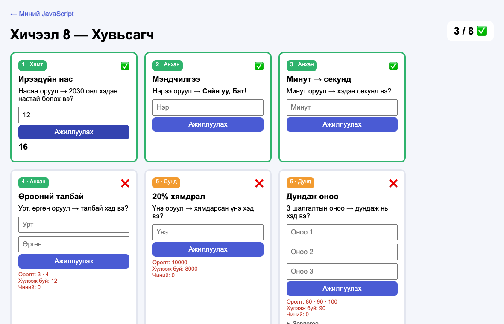
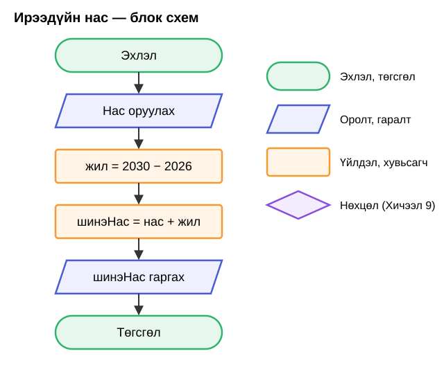

# Хичээл 8

### Өнөөдөр **JavaScript** бичиж эхэлнэ. Карт бүрт өөрөө код бичээд, ✅ цуглуулна.

> **Агуулга:** _(төлөвлөсөн)_ Блок схем (эхлэл, оролт/гаралт, үйлдэл), хувьсагч `let`, `+ - * /`, текст нийлүүлэх, `return`. `js-8.html`-ийн 8 картыг бодож, `js.html`-ээр portfolio-д холбох. Code Battle.



---

> Алхам бүр дээр **дарж нээнэ**.

---

<details>
<summary><b>1. Файлаа бэлд</b></summary>

<br>

1. Багшаас авсан 3 файлаа `my-first-web/` хавтсандаа хуул:

| Файл | Юу вэ |
| ---- | ----- |
| [js-8.html](js-8.html) | Өнөөдрийн бодлого — **энд бичнэ** |
| [helper.js](helper.js) | Картыг кодтой холбож, ✅ тавьдаг. **Засахгүй** |
| [js.html](js.html) | "Миний JavaScript" — бүх JS хичээлийн линк |

2. `my-first-web`-ийг VSCode-д нээ (**Open Folder**).
3. `js-8.html`-ийг браузерт нээ. VSCode, браузераа хагаслаад (Win + ← / →) зэрэгцүүл.

Код засах бүрт: **Ctrl+S** → браузерт **F5** (refresh).

</details>

---

<details>
<summary><b>2. Блок схем — кодоос өмнө зур</b></summary>

<br>

Компьютер кодыг **дээрээс доош, нэг мөрөөр** уншина. Блок схем = энэ дарааллын зураг.



Хэцүү бодлогыг эхлээд **цаасан дээр** зураад, дараа нь код болго.

</details>

---

<details>
<summary><b>3. Хувьсагч — нэртэй хайрцаг</b></summary>

<br>

```js
let jil = 2030 - 2026;   // jil хайрцагт 4
let ner = "Бат";         // текст — хашилтанд
let mend = "Сайн уу, " + ner + "!";   // "Сайн уу, Бат!"
```

| Код | Утга |
| --- | ---- |
| `let x = 5` | `x` хайрцаг үүсгэж 5 хийнэ |
| `+ - * /` | Нэмэх, хасах, үржих, хуваах |
| `( )` | Эхэлж бодно: `(2 + 4) / 2` → 3 |
| `"текст" + x` | Текст нийлүүлнэ |

<details>
<summary>Хувьсагчийн нэр</summary>

<br>

Латин үсэг, хоосон зайгүй: `shineNas`, `jil`. Монгол үсэг, `shine nas` — **болохгүй**.

</details>

</details>

---

<details>
<summary><b>4. Карт ↔ функц ↔ return</b></summary>

<br>

```text
Картын input (12)  →  function irehNas(nas)  →  return 16  →  Картан дээр: 16
```

- `nas` — картаас **бэлэн** ирсэн хайрцаг. Оруулсан тоо нь дотор нь байна.
- Хариугаа **`return`**-оор буцаа.
- Функцийн **дотор** л бич. Нэрийг нь бүү өөрчил.

</details>

---

<details>
<summary><b>5. Хамт: Ирээдүйн нас</b></summary>

<br>

Блок схем (2-р алхам) → код. Мөр бүр нэг дүрс:

| Блок схем | JS |
| --------- | -- |
| Нас оруулах | `function irehNas(nas)` — картаас ирнэ |
| жил = 2030 − 2026 | `let jil = 2030 - 2026;` |
| шинэНас = нас + жил | `let shineNas = nas + jil;` |
| шинэНас гаргах | `return shineNas;` |

```js
function irehNas(nas) {
  let jil = 2030 - 2026;
  let shineNas = nas + jil;
  return shineNas;
}
```

Ctrl+S → F5 → картын хүрээ **ногоон**, ✅ гарна.

</details>

---

<details>
<summary><b>6. Бие даан: 2–8</b></summary>

<br>

| Түвшин | Карт |
| ------ | ---- |
| Анхан | 2–4 |
| Дунд | 5–6 |
| Ахисан | 7–8 |

❌ гарвал улаан текстийг унш:

```text
Оролт: 3 · 4
Хүлээж буй: 12
Чиний: 7          ← нэмчихсэн байна, үржих ёстой
```

Гацвал карт доорх **Зөвлөгөө**-г нээ. Ахисан картуудыг эхлээд блок схемээр зур.

</details>

---

<details>
<summary><b>7. Code Battle 🏆</b></summary>

<br>

- Багш `tulaan-8.html` өгнө → `my-first-web`-д хуулж нээ. 5 карт = 5 раунд.
- "Раунд 1 — эхэл!" гэвэл **зөвхөн тэр картыг** бодно. ✅ гарвал гараа өргө.
- Хамгийн түрүүнд ✅ гаргасан 3 хүн: **3 · 2 · 1** оноо.

</details>

---

<details>
<summary><b>8. Portfolio-д холбох</b></summary>

<br>

1. `index.html`-ийн "Миний дасгалууд" хэсэгт линк нэм:

```html
<a href="js.html">Миний JavaScript</a>
```

2. Netlify → **Deploys** → `my-first-web` хавтсаа дахин чирж оруул.
3. AI Studio-ийн portfolio-д **гараараа** нэг карт нэм (Хичээл 7, 6-р алхам шиг):

| Карт | Утга |
| ---- | ---- |
| Гарчиг | JavaScript |
| Тайлбар | Бодлого, ✅ автомат шалгагчтай |
| Линк | `https://<чиний-сайт>.netlify.app/js.html` |

Энэ картыг **ганц удаа** нэмнэ. Дараагийн JS хичээлүүд `js.html`-д л нэмэгдэнэ.

</details>

---

<details>
<summary><b>Гэрийн даалгавар</b></summary>

<br>

| #   | Юу хийх | ✔️  |
| --- | ------- | --- |
| 1   | `js-8.html` — бүх карт ✅ (дор хаяж 1–6) | ⬜  |
| 2   | 8-р алхам: Netlify + portfolio-д "JavaScript" карт | ⬜  |
| 3   | Portfolio-гийн линкээ Discord-д тавь | ⬜  |

Дараагийн хичээлд: код **шийдвэр гаргадаг** болно — `if / else`.

</details>
