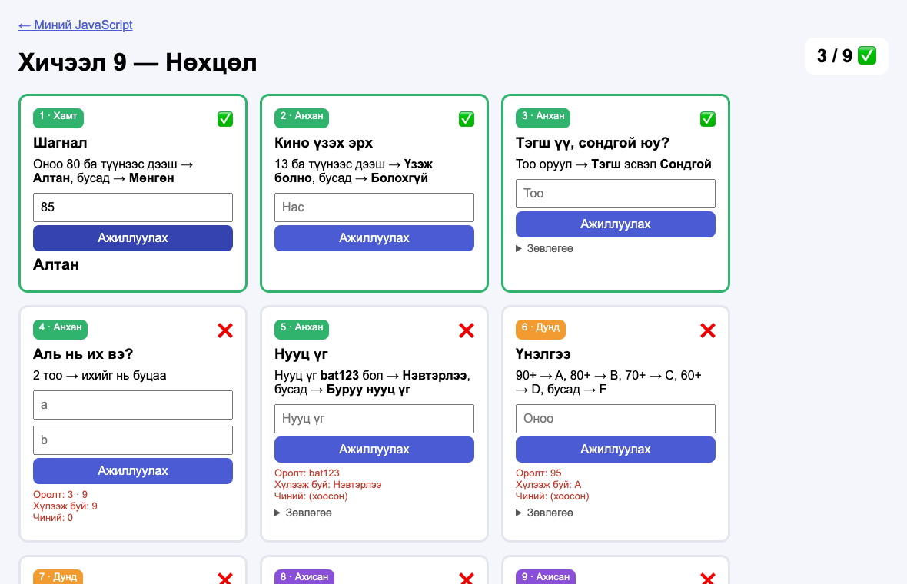
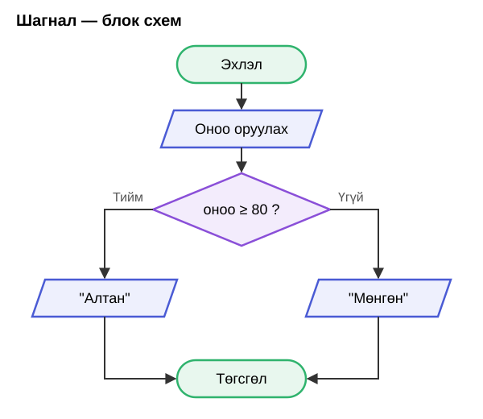

# Хичээл 9

### Өнөөдөр код **шийдвэр гаргадаг** болно: "Хэрэв … бол …, үгүй бол …".

> **Агуулга:** _(төлөвлөсөн)_ Блок схемийн ромбо (нөхцөл), `if / else`, `else if`, харьцуулалт (`>` `<` `>=` `<=` `===` `!==`), `%`, `&&` `||`. `js-9.html`-ийн 9 карт, Debug Battle.



---

> Алхам бүр дээр **дарж нээнэ**.

---

<details>
<summary><b>1. Файлаа бэлд</b></summary>

<br>

1. [js-9.html](js-9.html)-ийг `my-first-web/` хавтсандаа хуул. `helper.js` аль хэдийн байгаа.
2. VSCode + браузерт нээ. **0 / 9** гарч байна уу?

</details>

---

<details>
<summary><b>2. Блок схем — ромбо = асуулт</b></summary>

<br>

Ромбо нь **асуулт**. Хариу нь **Тийм** эсвэл **Үгүй**, зам хоёр салаална.



</details>

---

<details>
<summary><b>3. if / else</b></summary>

<br>

| Блок схем | JS |
| --------- | -- |
| ромбо: оноо ≥ 80 ? | `if (onoo >= 80) {` |
| Тийм → "Алтан" | `  return "Алтан";` |
| Үгүй | `} else {` |
| → "Мөнгөн" | `  return "Мөнгөн";` `}` |

```js
function shagnal(onoo) {
  if (onoo >= 80) {
    return "Алтан";
  } else {
    return "Мөнгөн";
  }
}
```

Карт 1-ийг ингэж хамт бичнэ.

</details>

---

<details>
<summary><b>4. Харьцуулах</b></summary>

<br>

| Код | Утга | `5 ? 3` |
| --- | ---- | ------- |
| `>` `<` | их, бага | `5 > 3` → true |
| `>=` `<=` | их буюу тэнцүү, бага буюу тэнцүү | `5 >= 5` → true |
| `===` | тэнцүү | `5 === 3` → false |
| `!==` | тэнцүү биш | `5 !== 3` → true |
| `n % 2` | 2-т хуваахад үлдэх үлдэгдэл | `7 % 2` → 1 |

<details>
<summary><code>=</code> ба <code>===</code></summary>

<br>

`=` — хайрцагт **хийх** (`let x = 5`). `===` — тэнцүү эсэхийг **асуух** (`if (x === 5)`).

</details>

</details>

---

<details>
<summary><b>5. else if — олон салаа</b></summary>

<br>

```js
if (onoo >= 90) {
  return "A";
} else if (onoo >= 80) {
  return "B";
} else {
  return "F";
}
```

Дээрээс доош шалгаж, **эхний таарсан** салаа л ажиллана. Тиймээс дараалал чухал. `>= 60`-ийг эхэнд тавивал 95 ч "D" болно.

</details>

---

<details>
<summary><b>6. && ба || — хоёр нөхцөл</b></summary>

<br>

| Код | Утга | Жишээ |
| --- | ---- | ----- |
| `&&` | **болон** — хоёулаа үнэн | `nas >= 13 && mungu >= 5000` |
| `\|\|` | **эсвэл** — нэг нь л үнэн | `on % 400 === 0 \|\| …` |

</details>

---

<details>
<summary><b>7. Бие даан: 2–9</b></summary>

<br>

| Түвшин | Карт |
| ------ | ---- |
| Анхан | 2–5 |
| Дунд | 6–7 |
| Ахисан | 8–9 — эхлээд блок схемээр зур |

Хуудасны дээр **⚠️ Кодонд алдаа** гарвал тэр мөрөнд хаалт `{ }` дутуу байна.

</details>

---

<details>
<summary><b>8. Debug Battle 🐞</b></summary>

<br>

- Багш `tulaan-9.html` өгнө. Карт бүрийн кодонд **1 алдаа** бий.
- Алдааг олж засаад ✅ гаргана. Яагаад буруу байсныг **нэг өгүүлбэрээр** хэлж чадвал оноо.
- Хамгийн түрүүнд засаж тайлбарласан 3 хүн: **3 · 2 · 1**.

</details>

---

<details>
<summary><b>9. Portfolio-д нэмэх</b></summary>

<br>

1. `js.html`-д Хичээл 8-ын хайрцгийг хуулж доор нь тавиад соль:

```html
<div class="hicheel">
  <div class="dugaar">9</div>
  <div>
    <h3><a href="js-9.html">Нөхцөл</a></h3>
    <p>Сурсан: if / else, else if, ===, &&, ||</p>
  </div>
</div>
```

2. Netlify → **Deploys** → `my-first-web`-ээ дахин чир. Portfolio-гийн "JavaScript" карт шинэчлэгдэнэ.

</details>

---

<details>
<summary><b>Гэрийн даалгавар</b></summary>

<br>

| #   | Юу хийх | ✔️  |
| --- | ------- | --- |
| 1   | `js-9.html` — бүх карт ✅ (дор хаяж 1–7) | ⬜  |
| 2   | 9-р алхам: `js.html` + Netlify | ⬜  |
| 3   | Карт 9 (Өндөр жил)-ийн блок схемийг цаасан дээр зурж, зургийг Discord-д тавь | ⬜  |

Дараагийн хичээлд: нэг зүйлийг **100 удаа** хийлгэнэ — давталт.

</details>
