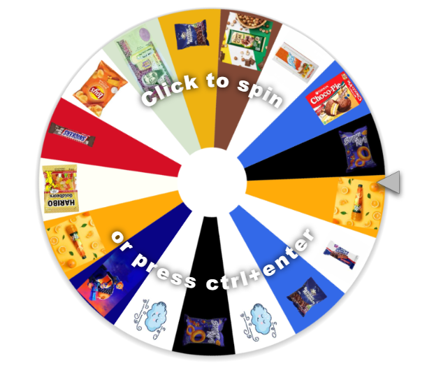
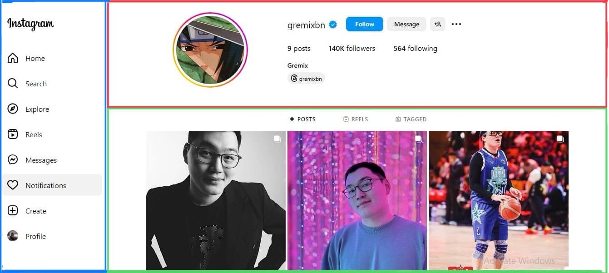

# Багийн тэмцээн — Хүрд эргүүлцгээе

> **Агуулга:** 2 хүний баг Web (зургаас хуудас хийх) эсвэл JavaScript бодлого хамтдаа хийнэ. Бодлого бүр leaderboard-д оноо өгч, түвшин дуусгах бүрт хүрд эргүүлнэ. JS хэсэг Хичээл 8–10-ын мэдлэг (`let`, `if`, `for`, `prompt`, `alert`) дээр суурилна.

---

> Хэсэг бүр дээр **дарж нээнэ**.

---

<b>Дүрэм</b>

 

1. **2 хүний** баг. Багийг багш leaderboard-оор хосолно.
2. Бодлого тооцогдохын тулд: код **ажилладаг** + багийн **хоёулаа** тайлбарлаж чаддаг байх. Ойлгоогүй нэгэндээ зааж өг.
3. Бодлого бүр **leaderboard-д оноо** өгнө — багийн хоёулаа авна.
4. Хэсэг/түвшин дуусгах бүрт **1 удаа хүрд** эргүүлнэ. **Түрүүлж** дуусгасан баг түрүүлж эргүүлнэ.
5. Хүрд дээр хоосон нүд бий. Шагнал хязгаартай — хурдан байх нь давуу.

Өмнөх хичээлүүдээ харж болно. Амжилт!

---

<b>1. Web — зургаас хуудас хийх</b>

 

Доорх хуудсыг хамтдаа хий. Зураг, icon-ууд [img](img/) хавтсанд байна.

| Хэсэг | Leaderboard | Хүрд |
| ----- | ----------- | ---- |
| Улаан | +3 | 1 удаа |
| Ногоон | +3 | 1 удаа |
| Цэнхэр | +3 | 1 удаа |

Хэсэг бүр: зурагтай **ойролцоо** харагдах + хоёулаа тайлбарлаж чадах.

---

<b>2. JavaScript — дүрэм</b>

 

- `main.js`-д бич. Оролт `Number(prompt())`, гаралт `alert`.
- Дуусгасан бодлогоо **Ctrl+/** (comment) — эс тэгвэл F5 бүрт бүх `prompt` дахин асууна.

| Түвшин | Бодлого | Leaderboard | Хүрд |
| ------ | ------- | ----------- | ---- |
| Хялбар | 1–3 | +1 тус бүр | 3-уулаа дуусвал 1 удаа |
| Дунд | 4–5 | +2 тус бүр | 2-уулаа дуусвал 1 удаа |
| Хэцүү | 6–7 | +3 тус бүр | тус бүр 1 удаа |

---

<b>Хялбар</b>

 

**1. Дэлгүүр**

Зайрмаг **1500₮**, чипс **2500₮**. Хэдэн зайрмаг, хэдэн чипс авахыг асууж (2 `prompt`), нийт үнийг гарга.

| зайрмаг | чипс | alert |
| ------- | ---- | ----- |
| 2 | 1 | 5500 |
| 0 | 3 | 7500 |

**2. Кино**

Насыг асуу. **13 ба түүнээс дээш** бол `Үзэж болно`, үгүй бол `Арай эрт байна`.

| prompt | alert |
| ------ | ----- |
| 13 | Үзэж болно |
| 10 | Арай эрт байна |

**3. Утасны цэнэг**

Цэнэг хэдэн хувь байгааг асуу. **20-оос бага** бол `Цэнэглэ!`, үгүй бол `Зүгээр`.

| prompt | alert |
| ------ | ----- |
| 15 | Цэнэглэ! |
| 20 | Зүгээр |

---

<b>Дунд</b>

 

**4. Тоглоомын цол**

Хэдэн XP цуглуулсныг асууж, цолыг гарга.

| XP | Цол |
| -- | --- |
| 0 – 99 | Шинэхэн |
| 100 – 499 | Дадлагатай |
| 500 ба түүнээс дээш | Мастер |

**5. Инээд**

Хэдэн удаа инээхийг асууж, тэр тоогоор `ха` давтан гарга.

| prompt | alert |
| ------ | ----- |
| 3 | хахаха |
| 5 | хахахахаха |

---

<b>Хэцүү</b>

 

**6. Лифт**

Байр хэдэн давхартайг асууж, лифтний товчны тоонуудыг гарга. **13-р давхар байхгүй** — алгас.

| prompt | alert |
| ------ | ----- |
| 15 | 1 2 3 4 5 6 7 8 9 10 11 12 14 15 |

**7. Хамгийн өндөр оноо**

5 тоглолтын оноог **давталт дотор** нэг нэгээр асууж, хамгийн өндрийг гарга.

| prompt (5 удаа) | alert |
| --------------- | ----- |
| 40, 75, 20, 90, 60 | Хамгийн өндөр: 90 |

Сануулга

`ih` гэсэн хувьсагчид одоогийн хамгийн өндрийг хадгал. Шинэ оноо түүнээс их бол `ih`-ийг шинэчил.

